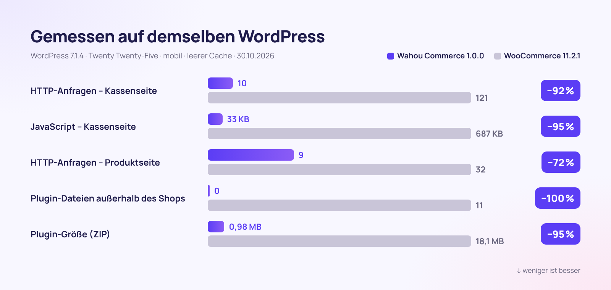

<div align="center">


[🇫🇷 Français](README.md) · [🇬🇧 English](README.en.md) · [🇪🇸 Español](README.es.md) · [🇮🇹 Italiano](README.it.md) · **🇩🇪 Deutsch** · [🇯🇵 日本語](README.ja.md) · [🇵🇹 Português](README.pt.md)

<br>


### Der WordPress-Shop, der mehr verkauft, weniger lädt und Ihre Kunden respektiert.

**[⬇️ v1.0.0 herunterladen](dist/wahou-commerce-1.0.0.zip)** · [🚀 In 5 Minuten startklar](#-in-5-minuten-startklar) · [🆚 Mit WooCommerce vergleichen](#-wahou-commerce-vs-woocommerce) · [👤 Der Autor](#-der-autor--thierry-gustin)

</div>

---


## ✨ Auf einen Blick

**Wahou Commerce** ist ein vollständiges E-Commerce-Plugin für WordPress – entwickelt für **Kreative, Verleger, Trainer und kleine europäische Marken**, die direkt verkaufen möchten: ohne Abo und ohne Provision auf ihre Umsätze.

Das Plugin beseitigt nacheinander genau die Reibungspunkte, die Kunden abspringen lassen und Händlern Zeit rauben:

- ⚡ **Von Grund auf schnell**: Außerhalb des Shops wird nichts geladen, und die Kassenseite kommt mit **20-mal weniger JavaScript** aus als die von WooCommerce.
- 📱 **Für den Daumen gemacht**: Checkout auf einer einzigen Seite, Apple Pay und Google Pay, kein überflüssiges Feld.
- 🇪🇺 **Bereit für Europa**: MwSt. aller 27 EU-Länder, OSS, live geprüftes B2B-Reverse-Charge-Verfahren, Omnibus-Regeln und Widerrufsrecht für digitale Inhalte.
- 🤖 **Sichtbar für KI**: `llms.txt`, Produktseiten als Markdown, vollständige strukturierte Daten und WordPress-Abilities für KI-Shopping-Agenten.
- 💸 **Automatisch mehr verkaufen**: Order Bump, 1-Klick-Upsell, Erinnerungen bei abgebrochenen Warenkörben und Direktkauf-Links.

## 📊 Die Zahlen



<table>
<tr>
<td align="center" width="33%"><h3>−95 %</h3>JavaScript auf der Kassenseite</td>
<td align="center" width="33%"><h3>0</h3>geladene Dateien außerhalb des Shops</td>
<td align="center" width="33%"><h3>0,98 MB</h3>für das komplette Plugin</td>
</tr>
<tr>
<td align="center"><h3>27</h3>MwSt.-Länder integriert und mit Quellen belegt</td>
<td align="center"><h3>3</h3>Sprachen inklusive (1.802 übersetzte Texte)</td>
<td align="center"><h3>7</h3>Schritte bis zum Shop-Start</td>
</tr>
</table>

<details>
<summary><b>Messmethode</b></summary>

Gemessen am 30.10.2026 auf zwei identischen Installationen: WordPress 7.1.4, Theme Twenty Twenty-Five, Standardeinstellungen, dieselben Produkte, kein Zahlungs-Gateway verbunden, mobiler Browser (390 px) mit leerem Cache. Verglichen wurde Wahou Commerce 1.0.0 mit WooCommerce 11.2.1 (neueste stabile Version). Das JavaScript wird in komprimierten KB (gzip) für die gesamte Seite gezählt: WordPress, Theme und Plugin.

| Seite | HTTP-Anfragen (Wahou / Woo) | JavaScript (Wahou / Woo) | Plugin-Dateien (Wahou / Woo) |
|---|---|---|---|
| Startseite (außerhalb des Shops) | 4 / 19 | 17 KB / 69 KB | 0 / 11 |
| Katalog | 10 / 31 | 26 KB / 77 KB | 2 / 20 |
| Produktseite | 9 / 32 | 26 KB / 96 KB | 2 / 23 |
| Kassenseite | 10 / 121 | 33 KB / 687 KB | 4 / 30 |

Im Demo-Shop, lokal gemessen: LCP einer Produktseite von 0,2 s, CLS von 0.
</details>

## 🆚 Wahou Commerce vs. WooCommerce

WooCommerce gilt als Referenz, und sein Ökosystem ist riesig. Wahou Commerce geht bewusst einen anderen Weg: **alles Wesentliche für den europäischen E-Commerce inklusive – in einem schlanken Plugin**.

| | **Wahou Commerce 1.0** | WooCommerce 11.2.1 allein |
|---|:---:|:---:|
| Plugin-Größe (ZIP) | **0,98 MB** | 18,1 MB |
| Geladene Dateien auf einer Seite außerhalb des Shops | **0** | 11 |
| HTTP-Anfragen auf der Kassenseite | **10** | 121 |
| Stripe, Apple Pay, Google Pay und PayPal | ✅ Webhooks automatisch eingerichtet | ➕ |
| MwSt.-Sätze der 27 Länder + OSS | ✅ | ⚙️ Sätze selbst eintragen |
| USt-IdNr. geprüft (VIES) + B2B-Reverse-Charge | ✅ | ➕ ¹ |
| Omnibus-Referenzpreis (30 Tage) | ✅ | ➕ |
| Checkbox für den Verzicht auf das Widerrufsrecht (digitale Inhalte) | ✅ | ➕ |
| Erinnerungen bei abgebrochenen Warenkörben | ✅ 3 E-Mails + Gutschein | ➕ |
| Order Bump, Upsell und Downsell mit 1 Klick | ✅ | ➕ |
| Fortlaufend nummerierte Rechnungen und Stornorechnungen | ✅ | ➕ |
| Kundenkonten ohne Passwort | ✅ Magic Link | ⚙️ Passwort |
| `llms.txt` und Markdown-Produktseiten für KI | ✅ | ➕ |
| Feed für Google Merchant Center | ✅ | ➕ |
| Ökosystem aus Plugins und Themes | 🌱 junges Projekt | ✅ riesig |
| Abonnements, Multi-Währung | 🗺️ auf der Roadmap | ➕ |

✅ inklusive · ⚙️ möglich, aber manuell · ➕ erfordert ein zusätzliches Plugin · 🗺️ geplant

¹ WooCommerce empfiehlt selbst seine Erweiterung [EU VAT Number](https://woocommerce.com/products/eu-vat-number/), um Umsatzsteuer-Identifikationsnummern zu erfassen und zu prüfen. Funktionsumfang am 30.10.2026 im Quellcode von WooCommerce 11.2.1 geprüft.

## 📱 Der Kaufprozess


| 1. Katalog | 2. Produktseite | 3. Kasse | 4. Bestätigung |
|---|---|---|---|
| Filter nach Kategorie, Sortierung, ehrliche Rabatt-Badges, schnelles Hinzufügen zum Warenkorb. | Omnibus-konformer Streichpreis, Highlights, verifizierte Bewertungen, Sofortkauf. | Eine einzige Seite, E-Mail zuerst, Adresse nur, wenn nötig. | Sofort-Downloads, Bankverbindung, Kundenkonto wird ohne Passwort angelegt. |

## 🧰 Alles inklusive

<table>
<tr>
<td width="50%" valign="top">

### 🛍️ Katalog
- Physische und digitale Produkte sowie Dienstleistungen
- Varianten mit Preis, Lagerbestand, SKU und Bild
- Bundles zum Festpreis oder mit prozentualem Rabatt
- Kundenbewertungen mit Badge „Verifizierter Kauf“
- Produkt-FAQ, Highlights, technisches Datenblatt

</td>
<td width="50%" valign="top">

### 💸 Conversion
- Slide-in-Warenkorb mit Fortschrittsbalken „Kostenloser Versand“
- Sticky-Kaufleiste auf Mobilgeräten
- Order Bump, Upsell und Downsell mit 1 Klick
- „Wird oft zusammen gekauft“ mit Rabatt
- Direktkauf-Links und Gutscheincodes per URL

</td>
</tr>
<tr>
<td valign="top">

### ✉️ Abgebrochene Warenkörbe
- E-Mail-Adresse wird schon bei der Eingabe erfasst – mit Einwilligung
- 3 planbare Erinnerungen (1 h, 24 h, 72 h)
- Persönlicher Einmal-Gutschein
- Link zum Fortsetzen des Kaufs und Abmeldung mit 1 Klick
- Statistiken: Rückgewinnungsquote und zurückgewonnener Umsatz

</td>
<td valign="top">

### 💳 Zahlungen
- Stripe: Karten, Apple Pay, Google Pay, Link
- PayPal, auch mit Ratenzahlung
- Banküberweisung (Vorkasse) mit reserviertem Lagerbestand
- Rückerstattungen direkt im Backend, inklusive Stornorechnung
- Kostenlose Bestellungen (Gutschein über 100 %)

</td>
</tr>
<tr>
<td valign="top">

### 🇪🇺 MwSt. & Compliance
- 27 Länder, inklusive Bücher und E-Books
- OSS, VIES, Gebiete außerhalb des MwSt.-Raums (Kanaren, frz. Überseedepartements)
- Omnibus-Referenzpreis über 30 Tage
- Widerrufsrecht bei digitalen Inhalten sauber abgebildet
- DSGVO: Datenexport und -löschung

</td>
<td valign="top">

### 🤖 SEO & GEO
- JSON-LD: Product, Offer, Bewertungen, FAQ, Breadcrumbs
- `llms.txt`, `llms-full.txt` und `.md`-Produktseiten
- Feed für Google Merchant Center
- WordPress-Abilities für KI-Agenten
- Anpassbare robots.txt für KI-Crawler

</td>
</tr>
<tr>
<td valign="top">

### 🌍 Mehrsprachigkeit
- Französisch, Spanisch und Englisch inklusive (deutsche Übersetzungen sind willkommen)
- Preise und Länder in der Sprache des Besuchers
- WPML und Polylang, gemeinsamer Lagerbestand
- E-Mails in der Sprache der Bestellung

</td>
<td valign="top">

### 🧭 Admin & Einrichtung
- Einrichtungsassistent in 7 Schritten
- Dashboard: Umsatz, durchschnittlicher Warenkorbwert, Bestseller
- CSV-Export für die Buchhaltung (MwSt. nach Steuersatz)
- Import von WooCommerce-Produkten

</td>
</tr>
</table>

## 🖥️ Eine übersichtliche Verwaltung


<table>
<tr>
<td width="50%"><br><sub><b>Assistent</b>: Stripe und PayPal sind verbunden, sobald Sie Ihre Schlüssel einfügen.</sub></td>
<td width="50%"><br><sub><b>Produkteditor</b>: das gesamte Produkt in einem einzigen Formular, übersichtlich in Tabs.</sub></td>
</tr>
<tr>
<td><br><sub><b>MwSt.</b>: Steuersätze der 27 Länder, für jedes Land einzeln anpassbar.</sub></td>
<td><br><sub><b>Abgebrochene Warenkörbe</b>: Erinnerungen und zurückgewonnener Umsatz.</sub></td>
</tr>
</table>

## ✉️ E-Mails, die Vertrauen schaffen


Bestellbestätigung mit Download-Links, detailliert ausgewiesener MwSt., Rechnung und Erinnerung an die erteilten rechtlichen Einwilligungen. Die E-Mails werden in der Sprache der Bestellung versendet.

## 🚀 In 5 Minuten startklar

1. **Laden Sie** [`wahou-commerce-1.0.0.zip`](dist/wahou-commerce-1.0.0.zip) **herunter**, dann in WordPress: **Plugins → Neues Plugin hinzufügen → Plugin hochladen**.
2. **Aktivieren Sie** das Plugin: Der Assistent öffnet sich und führt Sie in 7 Schritten durch die Einrichtung (Geschäft, MwSt., Zahlungen, Versand, Design, Seiten, Start).
3. **Fügen Sie Ihre Schlüssel** für [Stripe](https://dashboard.stripe.com/apikeys) und/oder [PayPal](https://developer.paypal.com/dashboard/applications) **ein**: Webhooks und Apple-Pay-Domain werden für Sie eingerichtet.
4. **Testen Sie** eine Bestellung im Testmodus und gehen Sie dann live.

Voraussetzungen: WordPress 6.5 oder neuer, PHP 8.1 oder höher sowie HTTPS für echte Zahlungen.

<details>
<summary><b>Erweiterte Einstellungen (wp-config.php, nginx)</b></summary>

```php
define( 'WAHOU_STRIPE_LIVE_SECRET', 'sk_live_...' );   // Konstanten haben Vorrang vor der Datenbank
define( 'WAHOU_PAYPAL_LIVE_SECRET', '...' );
define( 'WAHOU_ENCRYPTION_KEY', 'eine-lange-zufallszeichenkette' ); // Schlüssel zur Verschlüsselung der Secrets
define( 'WAHOU_TRUST_PROXY', true );                  // hinter Cloudflare oder einem Proxy
```

```nginx
location ~* /wp-content/uploads/(wahou-private|wahou-logs)/ { deny all; }
```
</details>

## 🔗 Kauflinks, überall einsetzbar

Teilen Sie einen Link, und Ihr Kunde landet direkt an der Kasse: ideal für die Instagram-Bio, einen Newsletter, einen QR-Code oder die letzte Seite eines E-Books.

```text
https://ihr-shop.de/?wahou_buy=123                    → direkt zur Kasse mit Produkt 123
https://ihr-shop.de/?wahou_buy=123&wahou_coupon=START → mit bereits eingelöstem Gutscheincode
https://ihr-shop.de/?wahou_add=123                    → in den Warenkorb legen
```

## 🤖 Bereit für die KI-Suche (GEO)

KI-Assistenten tun sich mit JavaScript schwer. Bei Wahou Commerce wird deshalb **der gesamte Inhalt serverseitig gerendert**, und jeder Shop veröffentlicht automatisch:

- `/llms.txt`: Ihr Shop, für KI zusammengefasst (Produkte, Versand, Rückgabe, Zahlung);
- `/produkt/mein-produkt.md`: jede Produktseite als Markdown, verknüpft über `rel="alternate"`;
- ein **vollständiges JSON-LD**: Preise inkl. MwSt., Verfügbarkeit, Rückgabebedingungen, Versandkosten und Lieferzeiten, Bewertungen, FAQ;
- **WordPress-Abilities** (6.9+): Produktsuche, Produktdetails, Shop-Infos und Bezahllink – von Agenten über den MCP-Adapter nutzbar.

```markdown
# Wahou Shop

- Währung: EUR
- Versand (Frankreich): 2–3 Werktage, 4,90 €, kostenlos ab 50,00 €
- Rückgabe: 14 Tage nach Lieferung für physische Produkte

## Produkte
- [Der Cocktail-Guide (E-Book)](https://wahou-shop.de/produkt/cocktail-guide-ebook.md): 120 Signature-Rezepte. – 14,90 € inkl. MwSt.
```

## 🇪🇺 EU-Konformität (geprüft am 30.10.2026)

| Vorgabe | Was Wahou Commerce tut | Quelle |
|---|---|---|
| OSS-Schwelle von 10.000 € | Unterhalb der Schwelle MwSt. des Verkäuferlandes, mit OSS-Option MwSt. des Kundenlandes | Richtlinie 2006/112/EG Art. 59c; [EU-Kommission – OSS](https://vat-one-stop-shop.ec.europa.eu/one-stop-shop_en) |
| Steuersätze der 27 Mitgliedstaaten | Integrierte Tabelle (Normalsatz, ermäßigte Sätze, Bücher, E-Books), anpassbar | [TEDB, Europäische Kommission](https://ec.europa.eu/taxation_customs/tedb/) |
| Gebiete außerhalb des MwSt.-Raums (Kanaren, Ceuta, Melilla, frz. Überseedepartements …), Monaco = Frankreich | Erkennung anhand von Land und Postleitzahl | Richtlinie 2006/112/EG Art. 6 und 7 |
| B2B-Reverse-Charge-Verfahren | USt-IdNr. live über [VIES](https://ec.europa.eu/taxation_customs/vies/) geprüft, Pflichtvermerk auf der Rechnung | Richtlinie Art. 196 und 138 |
| Rechnungsvermerke je nach Land des Verkäufers | ES: „Inversión del sujeto pasivo“ (Steuerschuldnerschaft des Leistungsempfängers); FR: „Autoliquidation“ (Reverse-Charge-Verfahren), „TVA non applicable, art. 293 B du CGI“ (Kleinunternehmerregelung, keine MwSt. ausgewiesen) | [RD 1619/2012](https://www.boe.es/eli/es/rd/2012/11/30/1619) (spanische Rechnungsverordnung); [CGI](https://www.legifrance.gouv.fr/codes/article_lc/LEGIARTI000050811276) (französisches Steuergesetzbuch) |
| Referenzpreis bei Rabattaktionen | Streichpreis = niedrigster Preis der 30 Tage vor der Preissenkung | [C. conso. L112-1-1](https://www.legifrance.gouv.fr/codes/article_lc/LEGIARTI000044549592) (französisches Verbraucherschutzgesetzbuch); [Ley 7/1996 art. 20](https://www.boe.es/buscar/act.php?id=BOE-A-1996-1072#a20) (spanisches Einzelhandelsgesetz); EuGH C-330/23 |
| Digitale Inhalte und Widerrufsrecht | Nicht vorausgewählte Pflicht-Checkbox + Hinweis in der E-Mail | Richtlinie 2011/83/EU Art. 16 Buchst. m; [C. conso. L221-28](https://www.legifrance.gouv.fr/codes/article_lc/LEGIARTI000044563170) |
| Eindeutige Bestellschaltfläche | „Jetzt zahlungspflichtig bestellen – 49,90 €“ (Text anpassbar) | Richtlinie 2011/83/EU Art. 8 Abs. 2; [C. conso. L221-14](https://www.legifrance.gouv.fr/codes/article_lc/LEGIARTI000032226854) |
| Barrierefreiheit (EAA) | Tastaturnavigation, Screenreader, Kontraste, reduzierte Bewegung | Richtlinie (EU) 2019/882, anwendbar seit dem 28.06.2025 |

<details>
<summary><b>⚠️ Gut zu wissen, bevor Sie Zahlungen annehmen</b></summary>

- **Spanien – VERI\*FACTU**: Die Rechnungen des Plugins sind nicht im VERI\*FACTU-Format. Geltende Stichtage: 1. Januar 2027 (Gesellschaften) und 1. Juli 2027 (autónomos, d. h. Selbstständige) ([RDL 15/2025](https://www.boe.es/buscar/doc.php?id=BOE-A-2025-24446)). Eine Verschiebung auf Oktober 2028 wurde am 05.10.2026 angekündigt, ist aber noch nicht im BOE (spanisches Amtsblatt) veröffentlicht ([Hinweis des spanischen Finanzministeriums](https://www.hacienda.gob.es/sgt/gabsehacienda/nota-informativa-verifactu.pdf)).
- **Frankreich – E-Rechnung**: Empfang seit dem 1. September 2026 verpflichtend; Ausstellung und E-Reporting spätestens ab dem 1. September 2027 für KMU und Kleinstunternehmen ([impots.gouv.fr](https://www.impots.gouv.fr/professionnel/je-passe-la-facturation-electronique)). Der CSV-Export für die Buchhaltung dient dafür als Grundlage.
- **OSS 2027**: Die Berechnung der Schwelle von 10.000 € ändert sich zum 1. Januar 2027 ([Richtlinie 2025/516](https://eur-lex.europa.eu/eli/dir/2025/516/oj)).
- Nicht unterstützte lokale Steuern: IGIC (Kanaren), IPSI (Ceuta, Melilla), Octroi de mer (frz. Überseedepartements).
</details>

## 🛡️ Sicherheit

- Secrets werden verschlüsselt in der Datenbank gespeichert (libsodium) und lassen sich per Konstanten überschreiben.
- Stripe-Webhooks sind signiert (HMAC-SHA256), PayPal-Webhooks werden über die PayPal-API verifiziert.
- Beträge werden stets serverseitig neu berechnet und mit der eingegangenen Zahlung abgeglichen.
- Digitale Dateien liegen außerhalb der Mediathek und werden über Tokens mit begrenzter Laufzeit und Nutzungsanzahl ausgeliefert.
- Nonces und Berechtigungsprüfungen bei jeder Aktion, eigene Rollen, Rate Limiting gegen „Card Testing“.

## 🧑‍💻 Für Entwickler

- Templates lassen sich in `ihr-theme/wahou-commerce/` überschreiben.
- REST-API `wahou/v1` (Warenkorb, Checkout, Bestellungen, Produkte) und Hooks, dokumentiert in [`docs/ARCHITECTURE.md`](docs/ARCHITECTURE.md).
- WP-CLI: `wp wahou status`, `wp wahou cron`, `wp wahou pages`.
- `bin/build.sh` erzeugt die minifizierten Dateien und das ZIP; mit `SCRIPT_DEBUG` werden die lesbaren Quelldateien ausgeliefert.
- Keine Composer- oder npm-Abhängigkeiten zur Laufzeit, kein jQuery im Shop-Frontend.

## 🗺️ Roadmap

- Abonnements (Stripe Billing) und Multi-Währung
- Facettenfilter und Benachrichtigungen bei Wiederverfügbarkeit
- VERI\*FACTU-Rechnungen (Spanien) und Übermittlung an eine zugelassene Plattform (Frankreich)
- Digitale Wasserzeichen für PDF/EPUB sowie Lizenzschlüssel

## 👤 Der Autor — Thierry Gustin

<table>
<tr>
<td valign="top">

Ich bin Franzose, lebe seit 14 Jahren in Madrid und spreche Französisch, Spanisch und Englisch. Als selbstständiger Unternehmer habe ich **[GustinAI](https://gustinai.com)** gegründet (KI-Schulungen für Unternehmen in Frankreich und Spanien).

Wahou Commerce habe ich aus eigenem Bedarf entwickelt: **direkt verkaufen, überall in Europa, ohne Abo und ohne Provision – und ohne meine Abende dafür zu opfern.**

**Meine Werte, in Code gegossen:**

- 🕊️ **Radikale Einfachheit**: Jedes eingesparte Feld und jeder eingesparte Klick zählt.
- ⏱️ **Zeit geht vor**: Was sich automatisieren lässt, läuft automatisch (Erinnerungen, Rechnungen, MwSt.).
- 🤝 **Respekt vor dem Kunden**: keine gefälschten Zähler, keine künstliche Dringlichkeit, dafür klare Preise.
- ⚖️ **Transparenz**: geprüfte Regeln, zitierte Quellen, offen benannte Grenzen.
- 🌍 **Mehrsprachiges Europa**: von Anfang an für Frankreich, Spanien und die gesamte EU gedacht.
- 🔓 **Unabhängigkeit**: Ihre Kunden, Ihre Daten, Ihr Shop – als freie Software.

[🌐 gustinai.com](https://gustinai.com) · [💻 GitHub @Jacckisback](https://github.com/Jacckisback)

</td>
</tr>
</table>

## 📄 Lizenz

[GPL-2.0-or-later](LICENSE) © Thierry Gustin. Sie dürfen das Plugin frei nutzen, verändern und weitergeben.

<div align="center">

**Wenn Wahou Commerce Ihnen Zeit spart, lassen Sie gern einen ⭐ auf GitHub da!**

</div>
