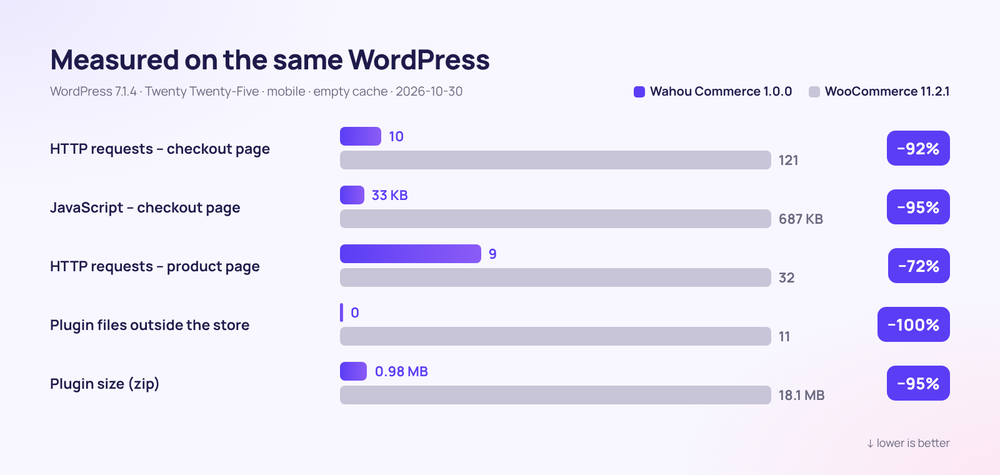

<div align="center">


[🇫🇷 Français](README.md) · **🇬🇧 English** · [🇪🇸 Español](README.es.md) · [🇮🇹 Italiano](README.it.md) · [🇩🇪 Deutsch](README.de.md) · [🇯🇵 日本語](README.ja.md) · [🇵🇹 Português](README.pt.md)

<br>


### The WordPress store that sells more, loads less and respects your customers.

**[⬇️ Download v1.0.0](dist/wahou-commerce-1.0.0.zip)** · [🚀 Get started in 5 minutes](#-get-started-in-5-minutes) · [🆚 Compare with WooCommerce](#-wahou-commerce-vs-woocommerce) · [👤 The author](#-the-author--thierry-gustin)

</div>

---


## ✨ At a glance

**Wahou Commerce** is a complete e-commerce plugin for WordPress, built for **creators, publishers, educators and small European brands** who want to sell direct, with no subscription and no commission on their sales.

It strips out, one by one, the friction points that drive customers away and eat up sellers' time:

- ⚡ **Fast by design**: nothing loads outside the store, and the checkout page ships **20 times less JavaScript** than WooCommerce's.
- 📱 **Thumb-friendly**: one-page checkout, Apple Pay and Google Pay, not a single unnecessary field.
- 🇪🇺 **Europe-ready**: VAT for all 27 countries, OSS, live-verified B2B reverse charge, Omnibus rules and the right of withdrawal for digital goods.
- 🤖 **Visible to AI**: `llms.txt`, Markdown product pages, complete structured data and WordPress Abilities for AI shopping agents.
- 💸 **Sell more, automatically**: order bump, one-click upsell, abandoned cart reminders and direct buy links.

## 📊 By the numbers



<table>
<tr>
<td align="center" width="33%"><h3>−95%</h3>JavaScript on the checkout page</td>
<td align="center" width="33%"><h3>0</h3>files loaded outside the store</td>
<td align="center" width="33%"><h3>0.98 MB</h3>for the complete plugin</td>
</tr>
<tr>
<td align="center"><h3>27</h3>countries' VAT rates built in, with cited sources</td>
<td align="center"><h3>3</h3>languages included (1,802 translated strings)</td>
<td align="center"><h3>7</h3>steps to launch your store</td>
</tr>
</table>

<details>
<summary><b>Measurement methodology</b></summary>

Measured on October 30, 2026, using two identical installs: WordPress 7.1.4, Twenty Twenty-Five theme, default settings, same products, no payment gateway connected, mobile browser (390 px) with an empty cache. Wahou Commerce 1.0.0 compared with WooCommerce 11.2.1 (latest stable release). JavaScript is counted in compressed KB (gzip) for the whole page: WordPress, theme and plugin.

| Page | Requests (Wahou / Woo) | JavaScript (Wahou / Woo) | Plugin files (Wahou / Woo) |
|---|---|---|---|
| Home page (outside the store) | 4 / 19 | 17 KB / 69 KB | 0 / 11 |
| Catalog | 10 / 31 | 26 KB / 77 KB | 2 / 20 |
| Product page | 9 / 32 | 26 KB / 96 KB | 2 / 23 |
| Checkout | 10 / 121 | 33 KB / 687 KB | 4 / 30 |

On the demo store, running locally: product page LCP of 0.2 s, CLS of 0.
</details>

## 🆚 Wahou Commerce vs WooCommerce

WooCommerce is an industry standard, and its ecosystem is vast. Wahou Commerce takes a different path: **every European e-commerce essential included, in one lightweight plugin**.

| | **Wahou Commerce 1.0** | WooCommerce 11.2.1 alone |
|---|:---:|:---:|
| Plugin size (zip) | **0.98 MB** | 18.1 MB |
| Files loaded on a non-store page | **0** | 11 |
| Requests on the checkout page | **10** | 121 |
| Stripe, Apple Pay, Google Pay and PayPal | ✅ webhooks configured automatically | ➕ |
| VAT rates for all 27 countries + OSS | ✅ | ⚙️ rates entered by hand |
| VAT number validation (VIES) + B2B reverse charge | ✅ | ➕ ¹ |
| Omnibus reference price (30 days) | ✅ | ➕ |
| Right-of-withdrawal waiver checkbox (digital) | ✅ | ➕ |
| Abandoned cart reminders | ✅ 3 emails + coupon | ➕ |
| 1-click order bump, upsell and downsell | ✅ | ➕ |
| Sequentially numbered invoices and credit notes | ✅ | ➕ |
| Passwordless customer accounts | ✅ magic link | ⚙️ password |
| `llms.txt` and Markdown product pages for AI | ✅ | ➕ |
| Google Merchant Center feed | ✅ | ➕ |
| Plugin and theme ecosystem | 🌱 young project | ✅ vast |
| Subscriptions, multi-currency | 🗺️ on the roadmap | ➕ |

✅ included · ⚙️ possible, but manual · ➕ requires an extension · 🗺️ planned

¹ WooCommerce itself recommends its own [EU VAT Number](https://woocommerce.com/products/eu-vat-number/) extension to collect and validate VAT numbers. Features checked against the WooCommerce 11.2.1 source code on October 30, 2026.

## 📱 The shopping journey


| 1. Catalog | 2. Product page | 3. Checkout | 4. Confirmation |
|---|---|---|---|
| Category filters, sorting, honest sale badges, quick add to cart. | Omnibus-compliant strikethrough price, key highlights, verified reviews, instant purchase. | A single page, email first, address only when needed. | Instant downloads, bank details, account created without a password. |

## 🧰 Everything included

<table>
<tr>
<td width="50%" valign="top">

### 🛍️ Catalog
- Physical products, digital products and services
- Variants with their own price, stock, SKU and image
- Bundles at a fixed price or a percentage off
- Customer reviews, “verified buyer” badge
- Product FAQ, key highlights, specifications

</td>
<td width="50%" valign="top">

### 💸 Conversion
- Cart drawer with a “free shipping” progress bar
- Sticky buy bar on mobile
- 1-click order bump, upsell and downsell
- “Frequently bought together” with a discount
- Direct buy links and promo codes via URL

</td>
</tr>
<tr>
<td valign="top">

### ✉️ Abandoned carts
- Email captured as soon as it's typed, with consent
- 3 reminders on a schedule you set (1 h, 24 h, 72 h)
- Personal, single-use coupon
- Cart recovery link and 1-click unsubscribe
- Stats: recovery rate and recovered revenue

</td>
<td valign="top">

### 💳 Payments
- Stripe: cards, Apple Pay, Google Pay, Link
- PayPal, including installment payments
- Bank transfer with reserved stock
- Refunds from the admin, with a credit note
- Free orders (100% coupon)

</td>
</tr>
<tr>
<td valign="top">

### 🇪🇺 VAT & compliance
- 27 countries, books and e-books included
- OSS, VIES, territories outside the VAT area (Canary Islands, French overseas departments)
- 30-day Omnibus reference price
- Digital right of withdrawal, handled by the book
- GDPR: data export and erasure

</td>
<td valign="top">

### 🤖 SEO & GEO
- JSON-LD: Product, Offer, reviews, FAQ, breadcrumbs
- `llms.txt`, `llms-full.txt` and `.md` product pages
- Google Merchant Center feed
- WordPress Abilities for AI agents
- Configurable robots.txt for AI crawlers

</td>
</tr>
<tr>
<td valign="top">

### 🌍 Multilingual
- French, Spanish and English included
- Prices and countries displayed in the visitor's language
- WPML and Polylang, with shared stock
- Emails sent in the language of the order

</td>
<td valign="top">

### 🧭 Admin & onboarding
- 7-step setup wizard
- Dashboard: revenue, average order value, best sellers
- Accounting CSV export (VAT by rate)
- WooCommerce product import

</td>
</tr>
</table>

## 🖥️ A crystal-clear admin


<table>
<tr>
<td width="50%"><br><sub><b>Setup wizard</b>: Stripe and PayPal connected just by pasting your keys.</sub></td>
<td width="50%"><br><sub><b>Product editor</b>: the whole product in a single form, organized in tabs.</sub></td>
</tr>
<tr>
<td><br><sub><b>VAT</b>: rates for all 27 countries, editable country by country.</sub></td>
<td><br><sub><b>Abandoned carts</b>: reminders and recovered revenue.</sub></td>
</tr>
</table>

## ✉️ Emails that build trust


A confirmation with download links, a detailed VAT breakdown, the invoice and a reminder of the legal consents given. Emails go out in the language of the order.

## 🚀 Get started in 5 minutes

1. **Download** [`wahou-commerce-1.0.0.zip`](dist/wahou-commerce-1.0.0.zip), then in WordPress go to **Plugins → Add New Plugin → Upload Plugin**.
2. **Activate** it: the setup wizard opens and walks you through 7 steps (business, VAT, payments, shipping, design, pages, launch).
3. **Paste your keys** from [Stripe](https://dashboard.stripe.com/apikeys) and/or [PayPal](https://developer.paypal.com/dashboard/applications): webhooks and your Apple Pay domain are configured for you.
4. **Test** an order in test mode, then go live.

Requirements: WordPress 6.5 or later, PHP 8.1 or later, and HTTPS for live payments.

<details>
<summary><b>Advanced settings (wp-config.php, nginx)</b></summary>

```php
define( 'WAHOU_STRIPE_LIVE_SECRET', 'sk_live_...' );   // constants take precedence over the database
define( 'WAHOU_PAYPAL_LIVE_SECRET', '...' );
define( 'WAHOU_ENCRYPTION_KEY', 'a-long-random-string' ); // key used to encrypt stored secrets
define( 'WAHOU_TRUST_PROXY', true );                  // behind Cloudflare or a proxy
```

```nginx
location ~* /wp-content/uploads/(wahou-private|wahou-logs)/ { deny all; }
```
</details>

## 🔗 Buy links, everywhere

Share a link and your customer lands straight on checkout: perfect for an Instagram bio, a newsletter, a QR code or the last page of an e-book.

```text
https://your-store.com/?wahou_buy=123                     → direct checkout for product 123
https://your-store.com/?wahou_buy=123&wahou_coupon=LAUNCH → with a promo code applied
https://your-store.com/?wahou_add=123                     → add to cart
```

## 🤖 Ready for AI search (GEO)

AI assistants struggle to read JavaScript. With Wahou Commerce, **all content is rendered server-side**, and every store automatically publishes:

- `/llms.txt`: your store summarized for AI (products, shipping, returns, payment);
- `/product/my-product.md`: every product page in Markdown, linked via `rel="alternate"`;
- **complete JSON-LD**: VAT-inclusive prices, availability, return policy, shipping costs and delivery times, reviews, FAQ;
- **WordPress Abilities** (6.9+): product search, product details, store info and checkout link, usable by an AI agent through the MCP Adapter.

```markdown
# Wahou Store

- Currency: EUR
- Delivery (France): 2–3 business days, €4.90, free from €50.00
- Returns: 14 days after delivery for physical products

## Products
- [The Cocktail Guide (e-book)](https://wahou-store.com/product/cocktail-guide-ebook.md): 120 signature recipes. – €14.90 incl. VAT
```

## 🇪🇺 EU compliance (verified on October 30, 2026)

| Rule | What Wahou Commerce does | Source |
|---|---|---|
| €10,000 OSS threshold | Seller's country VAT below the threshold; customer's country VAT with the OSS option | Directive 2006/112/EC, Art. 59c; [European Commission – OSS](https://vat-one-stop-shop.ec.europa.eu/one-stop-shop_en) |
| Rates for all 27 member states | Built-in table (standard, reduced, books, e-books), editable | [TEDB, European Commission](https://ec.europa.eu/taxation_customs/tedb/) |
| Territories outside the VAT area (Canary Islands, Ceuta, Melilla, French overseas departments…), Monaco = France | Detection by country and postal code | Directive 2006/112/EC, Arts. 6 and 7 |
| B2B reverse charge | VAT number checked live against [VIES](https://ec.europa.eu/taxation_customs/vies/), legal wording printed on the invoice | Directive, Arts. 196 and 138 |
| Invoice wording required in the seller's country | ES: « Inversión del sujeto pasivo » (reverse charge); FR: « Autoliquidation » (reverse charge), « TVA non applicable, art. 293 B du CGI » (VAT exemption for small businesses) | [RD 1619/2012](https://www.boe.es/eli/es/rd/2012/11/30/1619) (Spanish invoicing regulation); [CGI](https://www.legifrance.gouv.fr/codes/article_lc/LEGIARTI000050811276) (French General Tax Code) |
| Reference price for promotions | Strikethrough price = lowest price in the 30 days before the discount | [C. conso. L112-1-1](https://www.legifrance.gouv.fr/codes/article_lc/LEGIARTI000044549592) (French Consumer Code); [Ley 7/1996 art. 20](https://www.boe.es/buscar/act.php?id=BOE-A-1996-1072#a20) (Spanish Retail Trade Act); CJEU C-330/23 |
| Digital content and right of withdrawal | Mandatory checkbox, unchecked by default + reminder in the email | Directive 2011/83/EU, Art. 16(m); [C. conso. L221-28](https://www.legifrance.gouv.fr/codes/article_lc/LEGIARTI000044563170) |
| Explicit order button | “Pay now – €49.90” (label editable) | Directive 2011/83/EU, Art. 8(2); [C. conso. L221-14](https://www.legifrance.gouv.fr/codes/article_lc/LEGIARTI000032226854) |
| Accessibility (EAA) | Keyboard navigation, screen readers, contrast, reduced motion | Directive (EU) 2019/882, applicable since June 28, 2025 |

<details>
<summary><b>⚠️ Good to know before taking payments</b></summary>

- **Spain – VERI\*FACTU**: the plugin's invoices are not in VERI\*FACTU format. Effective dates: January 1, 2027 (companies) and July 1, 2027 (autónomos, i.e. the self-employed) ([RDL 15/2025](https://www.boe.es/buscar/doc.php?id=BOE-A-2025-24446)). A postponement to October 2028 was announced on October 5, 2026, but has not yet been published in the BOE, Spain's official gazette ([Hacienda notice](https://www.hacienda.gob.es/sgt/gabsehacienda/nota-informativa-verifactu.pdf)).
- **France – e-invoicing**: receiving e-invoices has been mandatory since September 1, 2026; issuing and e-reporting become mandatory by September 1, 2027 at the latest for SMEs and micro-enterprises ([impots.gouv.fr](https://www.impots.gouv.fr/professionnel/je-passe-la-facturation-electronique)). The accounting CSV export provides a starting point.
- **OSS 2027**: the way the €10,000 threshold is calculated changes on January 1, 2027 ([Directive 2025/516](https://eur-lex.europa.eu/eli/dir/2025/516/oj)).
- Local taxes not handled: IGIC (Canary Islands), IPSI (Ceuta, Melilla), octroi de mer (dock dues, French overseas departments).
</details>

## 🛡️ Security

- Secrets encrypted in the database (libsodium), overridable with constants.
- Stripe webhooks signed (HMAC-SHA256) and PayPal webhooks verified through the PayPal API.
- Amounts always recalculated server-side and checked against the payment received.
- Digital files kept outside the Media Library, served via time-limited, use-limited tokens.
- Nonces and capability checks on every action, dedicated roles, rate limiting against card testing.

## 🧑‍💻 For developers

- Overridable templates in `your-theme/wahou-commerce/`.
- `wahou/v1` REST API (cart, checkout, orders, products) and hooks, documented in [`docs/ARCHITECTURE.md`](docs/ARCHITECTURE.md).
- WP-CLI: `wp wahou status`, `wp wahou cron`, `wp wahou pages`.
- `bin/build.sh` generates the minified files and the zip; with `SCRIPT_DEBUG`, the readable sources are served instead.
- No Composer or npm dependencies at runtime, and no jQuery on the storefront.

## 🗺️ Roadmap

- Subscriptions (Stripe Billing) and multi-currency
- Faceted filters and back-in-stock alerts
- VERI\*FACTU invoices (Spain) and transmission to an approved e-invoicing platform (France)
- PDF/EPUB watermarking and license keys

## 👤 The author — Thierry Gustin

<table>
<tr>
<td valign="top">

I'm a French independent entrepreneur, and Madrid has been my home for 14 years. As a publisher with **Éditions Olibook**, I've released around 200 books in six languages, including the “Bible” series on topics such as artificial intelligence, cocktails and gardening. I'm also the founder of **[GustinAI](https://gustinai.com)** (AI training for businesses in France and Spain) and **[DelfOnline](https://delfonline.es)** (preparation for the DELF, DALF and TCF French-language exams).

I built Wahou Commerce for my own needs: **to sell direct, anywhere in Europe, with no subscription or commission, and without giving up my evenings.**

**My values, translated into code:**

- 🕊️ **Radical simplicity**: every field and every click removed makes a difference.
- ⏱️ **Time comes first**: anything that can be automated, is (reminders, invoices, VAT).
- 🤝 **Respect for customers**: no fake counters, no false urgency, just clear prices.
- ⚖️ **Transparency**: verified rules, cited sources, limits openly acknowledged.
- 🌍 **Multilingual Europe**: designed from day one for France, Spain and the entire EU.
- 🔓 **Independence**: your customers, your data, your store, powered by free software.

[🌐 gustinai.com](https://gustinai.com) · [📚 delfonline.es](https://delfonline.es) · [💻 GitHub @Jacckisback](https://github.com/Jacckisback)

</td>
</tr>
</table>

## 📄 License

[GPL-2.0-or-later](LICENSE) © Thierry Gustin. Free to use, modify and redistribute.

<div align="center">

**If Wahou Commerce saves you time, leave a ⭐ on GitHub!**

</div>
