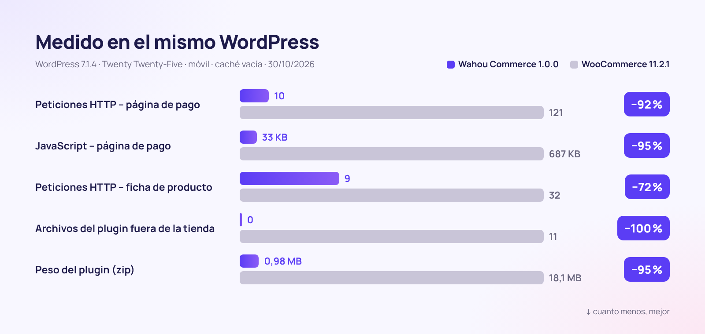
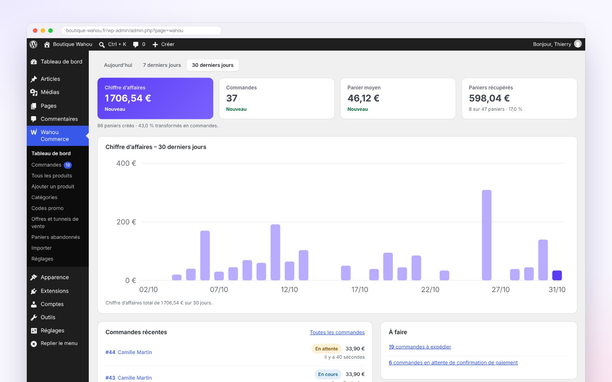
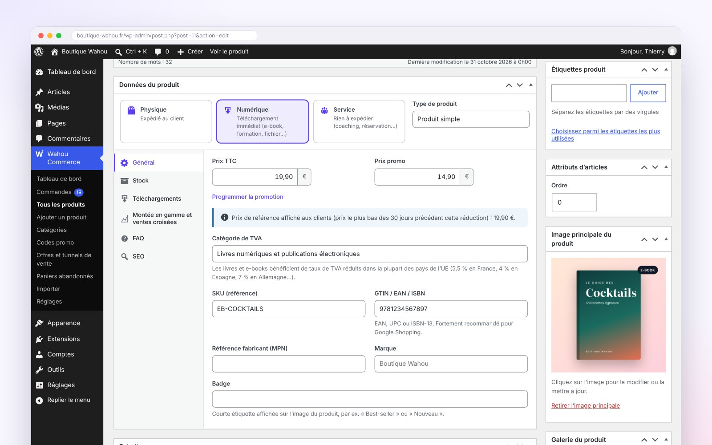
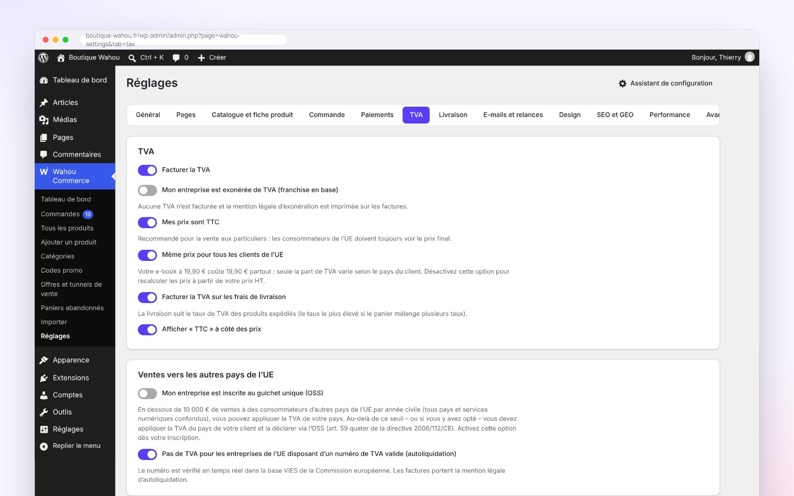
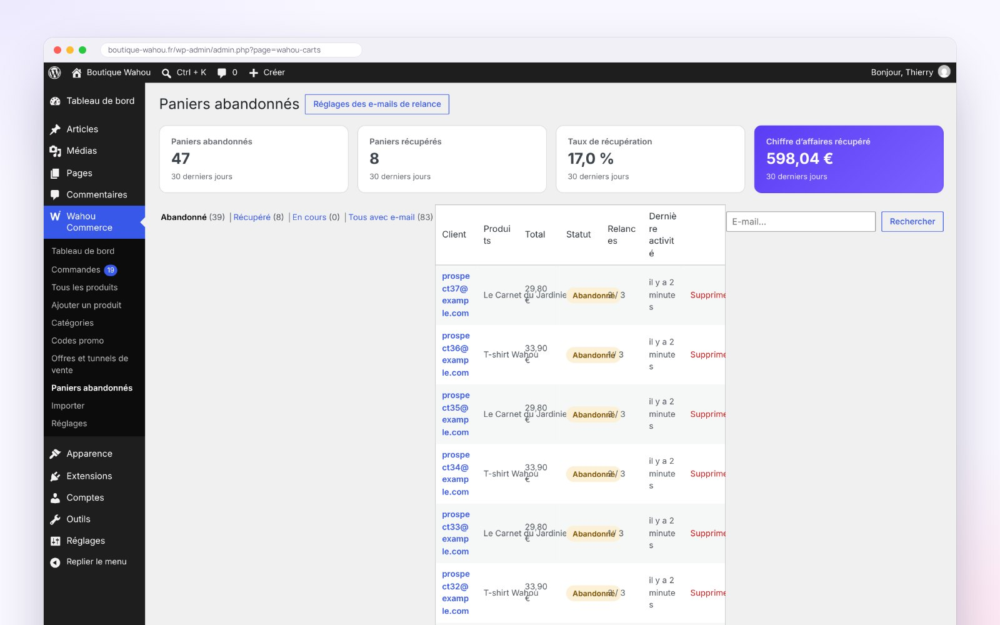

<div align="center">


[🇫🇷 Français](README.md) · [🇬🇧 English](README.en.md) · **🇪🇸 Español** · [🇮🇹 Italiano](README.it.md) · [🇩🇪 Deutsch](README.de.md) · [🇯🇵 日本語](README.ja.md) · [🇵🇹 Português](README.pt.md)

<br>


### La tienda WordPress que vende más, pesa menos y respeta a tus clientes.

**[⬇️ Descarga la v1.0.0](dist/wahou-commerce-1.0.0.zip)** · [🚀 Empieza en 5 minutos](#-empieza-en-5-minutos) · [🆚 Compara con WooCommerce](#-wahou-commerce-vs-woocommerce) · [👤 El autor](#-el-autor--thierry-gustin)

</div>

---


## ✨ En pocas palabras

**Wahou Commerce** es un plugin de e-commerce completo para WordPress, pensado para **creadores, editores, formadores y pequeñas marcas europeas** que quieren vender directamente, sin suscripciones ni comisiones sobre sus ventas.

Elimina, uno a uno, los puntos de fricción que ahuyentan a los clientes y hacen perder tiempo a los vendedores:

- ⚡ **Rápido por diseño**: no se carga nada fuera de la tienda y la página de pago usa **20 veces menos JavaScript** que la de WooCommerce.
- 📱 **Pensado para el pulgar**: pago en una sola página, Apple Pay y Google Pay, y ni un solo campo innecesario.
- 🇪🇺 **Listo para Europa**: IVA de los 27 países, OSS, inversión del sujeto pasivo B2B verificada en tiempo real, reglas Omnibus y derecho de desistimiento para contenido digital.
- 🤖 **Visible para las IA**: `llms.txt`, fichas en Markdown, datos estructurados completos y abilities de WordPress para los agentes de compra.
- 💸 **Vende más, automáticamente**: order bump, upsell en un clic, recordatorios de carritos abandonados y enlaces de compra directa.

## 📊 En cifras



<table>
<tr>
<td align="center" width="33%"><h3>−95 %</h3>de JavaScript en la página de pago</td>
<td align="center" width="33%"><h3>0</h3>archivos cargados fuera de la tienda</td>
<td align="center" width="33%"><h3>0,98 MB</h3>para el plugin completo</td>
</tr>
<tr>
<td align="center"><h3>27</h3>países con IVA integrado y fuentes citadas</td>
<td align="center"><h3>3</h3>idiomas incluidos (1802 textos traducidos)</td>
<td align="center"><h3>7</h3>pasos para lanzar tu tienda</td>
</tr>
</table>

<details>
<summary><b>Metodología de medición</b></summary>

Mediciones realizadas el 30/10/2026 en dos instalaciones idénticas: WordPress 7.1.4, tema Twenty Twenty-Five, ajustes por defecto, los mismos productos, ninguna pasarela de pago conectada y navegador móvil (390 px) con la caché vacía. Wahou Commerce 1.0.0 frente a WooCommerce 11.2.1 (última versión estable). El JavaScript se contabiliza en KB comprimidos (gzip) para toda la página: WordPress, tema y plugin.

| Página | Peticiones (Wahou / Woo) | JavaScript (Wahou / Woo) | Archivos del plugin (Wahou / Woo) |
|---|---|---|---|
| Inicio (fuera de la tienda) | 4 / 19 | 17 KB / 69 KB | 0 / 11 |
| Catálogo | 10 / 31 | 26 KB / 77 KB | 2 / 20 |
| Ficha de producto | 9 / 32 | 26 KB / 96 KB | 2 / 23 |
| Pago | 10 / 121 | 33 KB / 687 KB | 4 / 30 |

En la tienda de demostración, en local: LCP de 0,2 s en una ficha de producto y CLS de 0.
</details>

## 🆚 Wahou Commerce vs WooCommerce

WooCommerce es un referente y su ecosistema es inmenso. Wahou Commerce apuesta por otro camino: **todo lo esencial del e-commerce europeo incluido, en un plugin ligero**.

| | **Wahou Commerce 1.0** | WooCommerce 11.2.1 sin extensiones |
|---|:---:|:---:|
| Peso del plugin (zip) | **0,98 MB** | 18,1 MB |
| Archivos cargados en una página fuera de la tienda | **0** | 11 |
| Peticiones en la página de pago | **10** | 121 |
| Stripe, Apple Pay, Google Pay y PayPal | ✅ webhooks configurados automáticamente | ➕ |
| Tipos de IVA de los 27 países + OSS | ✅ | ⚙️ hay que introducir los tipos |
| Número de IVA verificado (VIES) + inversión del sujeto pasivo B2B | ✅ | ➕ ¹ |
| Precio de referencia Omnibus (30 días) | ✅ | ➕ |
| Casilla de renuncia al derecho de desistimiento (contenido digital) | ✅ | ➕ |
| Recordatorios de carritos abandonados | ✅ 3 emails + cupón | ➕ |
| Order bump, upsell y downsell en 1 clic | ✅ | ➕ |
| Facturas y facturas rectificativas numeradas | ✅ | ➕ |
| Cuentas de cliente sin contraseña | ✅ enlace mágico | ⚙️ contraseña |
| `llms.txt` y fichas en Markdown para las IA | ✅ | ➕ |
| Feed de Google Merchant Center | ✅ | ➕ |
| Ecosistema de extensiones y temas | 🌱 proyecto joven | ✅ inmenso |
| Suscripciones, multidivisa | 🗺️ hoja de ruta | ➕ |

✅ incluido · ⚙️ posible, pero manual · ➕ requiere una extensión · 🗺️ previsto

¹ El propio WooCommerce recomienda su extensión [EU VAT Number](https://woocommerce.com/products/eu-vat-number/) para recopilar y validar los números de IVA. Funcionalidades verificadas en el código fuente de WooCommerce 11.2.1 el 30/10/2026.

## 📱 El proceso de compra


| 1. Catálogo | 2. Ficha de producto | 3. Pago | 4. Confirmación |
|---|---|---|---|
| Filtros por categoría, ordenación, etiquetas de promoción honestas, añadido rápido al carrito. | Precio tachado conforme a Omnibus, puntos fuertes, valoraciones verificadas, compra inmediata. | Una sola página, primero el email, la dirección solo si hace falta. | Descargas inmediatas, datos bancarios, cuenta creada sin contraseña. |

## 🧰 Todo lo que incluye

<table>
<tr>
<td width="50%" valign="top">

### 🛍️ Catálogo
- Productos físicos, digitales y servicios
- Variantes con precio, stock, SKU e imagen
- Packs a precio fijo o con descuento porcentual
- Valoraciones de clientes con distintivo «compra verificada»
- FAQ del producto, puntos fuertes, ficha técnica

</td>
<td width="50%" valign="top">

### 💸 Conversión
- Carrito lateral con barra de «envío gratis»
- Barra de compra fija en el móvil
- Order bump, upsell y downsell en 1 clic
- «Comprados juntos habitualmente» con descuento
- Enlaces de compra directa y códigos de descuento por URL

</td>
</tr>
<tr>
<td valign="top">

### ✉️ Carritos abandonados
- Email capturado en cuanto se escribe, con consentimiento
- 3 recordatorios programables (1 h, 24 h, 72 h)
- Cupón personal de un solo uso
- Enlace para retomar la compra y baja en 1 clic
- Estadísticas: tasa de recuperación e ingresos recuperados

</td>
<td valign="top">

### 💳 Pagos
- Stripe: tarjetas, Apple Pay, Google Pay, Link
- PayPal, con pago a plazos
- Transferencia bancaria con stock reservado
- Reembolsos desde el panel, con factura rectificativa
- Pedidos gratuitos (cupón del 100 %)

</td>
</tr>
<tr>
<td valign="top">

### 🇪🇺 IVA y cumplimiento normativo
- 27 países, libros y e-books incluidos
- OSS, VIES, territorios fuera del ámbito del IVA (Canarias, DOM franceses)
- Precio de referencia Omnibus de 30 días
- Derecho de desistimiento digital bien gestionado
- RGPD: exportación y supresión de datos

</td>
<td valign="top">

### 🤖 SEO y GEO
- JSON-LD: Product, Offer, valoraciones, FAQ, migas de pan
- `llms.txt`, `llms-full.txt` y fichas `.md`
- Feed de Google Merchant Center
- Abilities de WordPress para agentes de IA
- robots.txt configurable para los rastreadores de IA

</td>
</tr>
<tr>
<td valign="top">

### 🌍 Multilingüe
- Francés, español e inglés incluidos
- Precios y países mostrados en el idioma del visitante
- WPML y Polylang, con stock compartido
- Emails en el idioma del pedido

</td>
<td valign="top">

### 🧭 Administración y puesta en marcha
- Asistente de configuración en 7 pasos
- Panel: ingresos, ticket medio y más vendidos
- Exportación contable en CSV (IVA por tipo)
- Importación de productos desde WooCommerce

</td>
</tr>
</table>

## 🖥️ Un panel de administración claro



<table>
<tr>
<td width="50%"><br><sub><b>Asistente</b>: Stripe y PayPal conectados con solo pegar tus claves.</sub></td>
<td width="50%"><br><sub><b>Editor de producto</b>: todo el producto en un único formulario, organizado en pestañas.</sub></td>
</tr>
<tr>
<td><br><sub><b>IVA</b>: tipos de los 27 países, editables país por país.</sub></td>
<td><br><sub><b>Carritos abandonados</b>: recordatorios e ingresos recuperados.</sub></td>
</tr>
</table>

## ✉️ Emails que inspiran confianza


Confirmación con enlaces de descarga, IVA desglosado, factura y recordatorio de los consentimientos legales. Los emails se envían en el idioma del pedido.

## 🚀 Empieza en 5 minutos

1. **Descarga** [`wahou-commerce-1.0.0.zip`](dist/wahou-commerce-1.0.0.zip) y, en WordPress, ve a **Plugins → Añadir nuevo plugin → Subir plugin**.
2. **Actívalo**: se abre el asistente, que te guía en 7 pasos (actividad, IVA, pagos, envíos, diseño, páginas y lanzamiento).
3. **Pega tus claves** de [Stripe](https://dashboard.stripe.com/apikeys) y/o [PayPal](https://developer.paypal.com/dashboard/applications): los webhooks y el dominio de Apple Pay se configuran por ti.
4. **Comprueba** que todo funciona con un pedido en modo de prueba y, después, pasa a producción.

Requisitos: WordPress 6.5 o posterior, PHP 8.1 o superior y HTTPS para los pagos reales.

<details>
<summary><b>Ajustes avanzados (wp-config.php, nginx)</b></summary>

```php
define( 'WAHOU_STRIPE_LIVE_SECRET', 'sk_live_...' );   // las constantes tienen prioridad sobre la base de datos
define( 'WAHOU_PAYPAL_LIVE_SECRET', '...' );
define( 'WAHOU_ENCRYPTION_KEY', 'una-cadena-larga-y-aleatoria' ); // clave de cifrado de los secretos
define( 'WAHOU_TRUST_PROXY', true );                  // detrás de Cloudflare o de un proxy
```

```nginx
location ~* /wp-content/uploads/(wahou-private|wahou-logs)/ { deny all; }
```
</details>

## 🔗 Enlaces de compra en todas partes

Comparte un enlace y tu cliente llega directamente al pago: ideal para la bio de Instagram, una newsletter, un código QR o la última página de un e-book.

```text
https://tu-tienda.es/?wahou_buy=123                          → pago directo del producto 123
https://tu-tienda.es/?wahou_buy=123&wahou_coupon=LANZAMIENTO → con el código de descuento ya aplicado
https://tu-tienda.es/?wahou_add=123                          → añadir al carrito
```

## 🤖 Preparado para la búsqueda con IA (GEO)

A los asistentes de IA les cuesta leer JavaScript: con Wahou Commerce, **todo el contenido se renderiza en el servidor** y cada tienda publica automáticamente:

- `/llms.txt`: tu tienda resumida para las IA (productos, envíos, devoluciones, pago);
- `/producto/mi-producto.md`: cada ficha en Markdown, enlazada mediante `rel="alternate"`;
- un **JSON-LD completo**: precio con IVA incluido, disponibilidad, política de devoluciones, gastos y plazos de envío, valoraciones, FAQ;
- las **abilities de WordPress** (6.9+): búsqueda de productos, ficha, información de la tienda y enlace de pago, que un agente puede usar a través del adaptador MCP.

```markdown
# Tienda Wahou

- Moneda: EUR
- Envío (España): 2 a 3 días laborables, 4,90 €, gratis desde 50,00 €
- Devoluciones: 14 días tras la entrega para productos físicos

## Productos
- [La Guía de los Cócteles (e-book)](https://tienda-wahou.es/producto/guia-de-cocteles-ebook.md): 120 recetas exclusivas. – 14,90 € IVA incl.
```

## 🇪🇺 Cumplimiento de la normativa europea (verificado el 30/10/2026)

| Norma | Qué hace Wahou Commerce | Fuente |
|---|---|---|
| Umbral OSS de 10 000 € | IVA del país del vendedor por debajo del umbral; del país del cliente con la opción OSS | Directiva 2006/112/CE art. 59 quater; [Comisión – OSS](https://vat-one-stop-shop.ec.europa.eu/one-stop-shop_en) |
| Tipos de los 27 Estados miembros | Tabla integrada (general, reducidos, libros, e-books), editable | [TEDB, Comisión Europea](https://ec.europa.eu/taxation_customs/tedb/) |
| Territorios fuera del ámbito del IVA (Canarias, Ceuta, Melilla, DOM franceses…), Mónaco = Francia | Detección por país y código postal | Directiva 2006/112/CE art. 6 y 7 |
| Inversión del sujeto pasivo B2B | Número verificado en tiempo real en [VIES](https://ec.europa.eu/taxation_customs/vies/), mención legal en la factura | Directiva art. 196 y 138 |
| Menciones en la factura según el país del vendedor | ES: «Inversión del sujeto pasivo»; FR: «Autoliquidation» (inversión del sujeto pasivo), «TVA non applicable, art. 293 B du CGI» (IVA no aplicable, régimen de franquicia) | [RD 1619/2012](https://www.boe.es/eli/es/rd/2012/11/30/1619); [CGI](https://www.legifrance.gouv.fr/codes/article_lc/LEGIARTI000050811276) |
| Precio de referencia en las promociones | Precio tachado = el más bajo de los 30 días anteriores a la rebaja | [C. conso. L112-1-1](https://www.legifrance.gouv.fr/codes/article_lc/LEGIARTI000044549592) (Código de Consumo francés); [Ley 7/1996 art. 20](https://www.boe.es/buscar/act.php?id=BOE-A-1996-1072#a20); TJUE C-330/23 |
| Contenido digital y derecho de desistimiento | Casilla obligatoria sin marcar por defecto + recordatorio en el email | Directiva 2011/83/UE art. 16 m); [C. conso. L221-28](https://www.legifrance.gouv.fr/codes/article_lc/LEGIARTI000044563170) |
| Botón de pedido explícito | «Pagar ahora – 49,90 €» (texto editable) | Directiva 2011/83/UE art. 8(2); [C. conso. L221-14](https://www.legifrance.gouv.fr/codes/article_lc/LEGIARTI000032226854) |
| Accesibilidad (EAA) | Navegación por teclado, lectores de pantalla, contrastes, movimiento reducido | Directiva (UE) 2019/882, aplicable desde el 28/06/2025 |

<details>
<summary><b>⚠️ Lo que debes saber antes de empezar a cobrar</b></summary>

- **España – VERI\*FACTU**: las facturas del plugin no tienen formato VERI\*FACTU. Fechas vigentes: 1 de enero de 2027 (sociedades) y 1 de julio de 2027 (autónomos) ([RDL 15/2025](https://www.boe.es/buscar/doc.php?id=BOE-A-2025-24446)). El 05/10/2026 se anunció un aplazamiento a octubre de 2028, pero todavía no se ha publicado en el BOE ([nota de Hacienda](https://www.hacienda.gob.es/sgt/gabsehacienda/nota-informativa-verifactu.pdf)).
- **Francia – facturación electrónica**: recepción obligatoria desde el 1 de septiembre de 2026; emisión y e-reporting a más tardar el 1 de septiembre de 2027 para pymes y microempresas ([impots.gouv.fr](https://www.impots.gouv.fr/professionnel/je-passe-la-facturation-electronique)). La exportación contable en CSV sirve de base.
- **OSS 2027**: el cálculo del umbral de 10 000 € cambia el 1 de enero de 2027 ([Directiva 2025/516](https://eur-lex.europa.eu/eli/dir/2025/516/oj)).
- Impuestos locales no gestionados: IGIC (Canarias), IPSI (Ceuta y Melilla), octroi de mer (DOM franceses).
</details>

## 🛡️ Seguridad

- Secretos cifrados en la base de datos (libsodium), que se pueden sobrescribir con constantes.
- Webhooks de Stripe firmados (HMAC-SHA256) y de PayPal verificados mediante la API de PayPal.
- Importes siempre recalculados en el servidor y comparados con el pago recibido.
- Archivos digitales fuera de la biblioteca de medios, servidos mediante tokens de duración y usos limitados.
- Nonces y capacidades en cada acción, roles específicos y limitación de peticiones contra el «card testing».

## 🧑‍💻 Para desarrolladores

- Plantillas que puedes sobrescribir en `tu-tema/wahou-commerce/`.
- API REST `wahou/v1` (carrito, pago, pedidos, productos) y hooks documentados en [`docs/ARCHITECTURE.md`](docs/ARCHITECTURE.md).
- WP-CLI: `wp wahou status`, `wp wahou cron`, `wp wahou pages`.
- `bin/build.sh` genera los archivos minificados y el zip; con `SCRIPT_DEBUG`, se sirven las fuentes legibles.
- Sin dependencias de Composer ni de npm en tiempo de ejecución, y sin jQuery en la tienda.

## 🗺️ Hoja de ruta

- Suscripciones (Stripe Billing) y multidivisa
- Filtros por facetas y avisos de reposición de stock
- Facturas VERI\*FACTU (España) y transmisión a una plataforma autorizada (Francia)
- Marca de agua digital en PDF/EPUB y claves de licencia

## 👤 El autor — Thierry Gustin

<table>
<tr>
<td valign="top">

Francés afincado en Madrid desde hace 14 años y trilingüe (francés, español e inglés), soy emprendedor independiente y fundador de **[GustinAI](https://gustinai.com)** (formación en IA para empresas en Francia y España).

Creé Wahou Commerce para cubrir mis propias necesidades: **vender directamente, en toda Europa, sin suscripciones ni comisiones, y sin pasarme las noches con ello.**

**Mis valores, traducidos a código:**

- 🕊️ **Simplicidad radical**: cada campo y cada clic de menos cuenta.
- ⏱️ **El tiempo, ante todo**: todo lo que se puede automatizar está automatizado (recordatorios, facturas, IVA).
- 🤝 **Respeto al cliente**: ni contadores falsos ni urgencias inventadas, y precios claros.
- ⚖️ **Transparencia**: normas verificadas, fuentes citadas y límites asumidos.
- 🌍 **Europa multilingüe**: pensado desde el principio para Francia, España y toda la UE.
- 🔓 **Independencia**: tus clientes, tus datos, tu tienda, con software libre.

[🌐 gustinai.com](https://gustinai.com) · [💻 GitHub @Jacckisback](https://github.com/Jacckisback)

</td>
</tr>
</table>

## 📄 Licencia

[GPL-2.0-or-later](LICENSE) © Thierry Gustin. Libre para usar, modificar y redistribuir.

<div align="center">

**Si Wahou Commerce te ahorra tiempo, ¡déjale una ⭐ en GitHub!**

</div>
