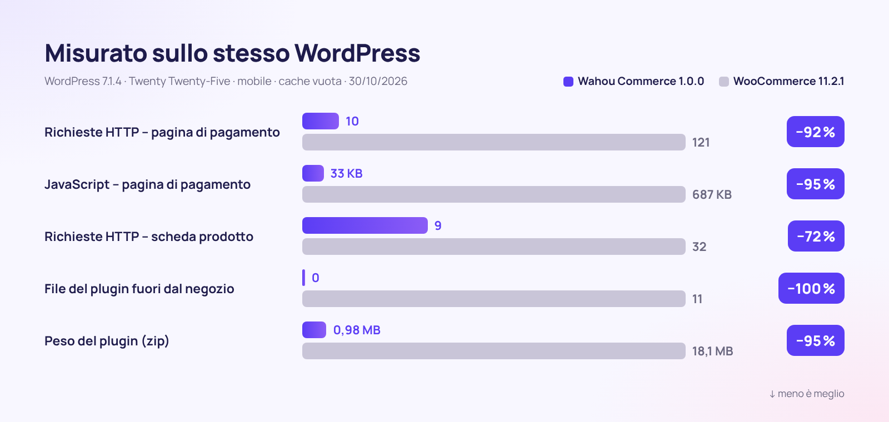

<div align="center">


[🇫🇷 Français](README.md) · [🇬🇧 English](README.en.md) · [🇪🇸 Español](README.es.md) · **🇮🇹 Italiano** · [🇩🇪 Deutsch](README.de.md) · [🇯🇵 日本語](README.ja.md) · [🇵🇹 Português](README.pt.md)

<br>


### Il negozio WordPress che vende di più, pesa di meno e rispetta i tuoi clienti.

**[⬇️ Scarica la v1.0.0](dist/wahou-commerce-1.0.0.zip)** · [🚀 Inizia in 5 minuti](#-inizia-in-5-minuti) · [🆚 Confronta con WooCommerce](#-wahou-commerce-vs-woocommerce) · [👤 L'autore](#-lautore--thierry-gustin)

</div>

---


## ✨ In breve

**Wahou Commerce** è un plugin e-commerce completo per WordPress, pensato per **creator, editori, formatori e piccoli brand europei** che vogliono vendere direttamente, senza abbonamenti né commissioni sulle vendite.

Elimina, uno dopo l'altro, i punti di attrito che fanno scappare i clienti e fanno perdere tempo a chi vende:

- ⚡ **Veloce fin dalle fondamenta**: fuori dal negozio non viene caricato nulla e la pagina di pagamento carica **20 volte meno JavaScript** di quella di WooCommerce.
- 📱 **A misura di pollice**: pagamento su un'unica pagina, Apple Pay e Google Pay, nessun campo superfluo.
- 🇪🇺 **Pronto per l'Europa**: IVA dei 27 Paesi, OSS, reverse charge B2B con verifica in tempo reale, regole Omnibus e diritto di recesso per i contenuti digitali.
- 🤖 **Visibile alle IA**: `llms.txt`, schede in Markdown, dati strutturati completi e abilities WordPress per gli agenti di acquisto.
- 💸 **Vendere di più, in automatico**: order bump, upsell in un clic, recupero dei carrelli abbandonati e link di acquisto diretto.

## 📊 I numeri



<table>
<tr>
<td align="center" width="33%"><h3>−95%</h3>di JavaScript nella pagina di pagamento</td>
<td align="center" width="33%"><h3>0</h3>file caricati fuori dal negozio</td>
<td align="center" width="33%"><h3>0,98 MB</h3>per il plugin completo</td>
</tr>
<tr>
<td align="center"><h3>27</h3>Paesi con IVA integrata e fonti citate</td>
<td align="center"><h3>3</h3>lingue incluse (1.802 testi tradotti)</td>
<td align="center"><h3>7</h3>passaggi per lanciare il negozio</td>
</tr>
</table>

<details>
<summary><b>Metodo di misurazione</b></summary>

Misurazioni effettuate il 30/10/2026 su due installazioni identiche: WordPress 7.1.4, tema Twenty Twenty-Five, impostazioni predefinite, stessi prodotti, nessun gateway di pagamento collegato, browser mobile (390 px) con cache vuota. Wahou Commerce 1.0.0 confrontato con WooCommerce 11.2.1 (ultima versione stabile). Il JavaScript è conteggiato in KB compressi (gzip) sull'intera pagina: WordPress, tema e plugin.

| Pagina | Richieste (Wahou / Woo) | JavaScript (Wahou / Woo) | File del plugin (Wahou / Woo) |
|---|---|---|---|
| Home page (fuori dal negozio) | 4 / 19 | 17 KB / 69 KB | 0 / 11 |
| Catalogo | 10 / 31 | 26 KB / 77 KB | 2 / 20 |
| Scheda prodotto | 9 / 32 | 26 KB / 96 KB | 2 / 23 |
| Pagamento | 10 / 121 | 33 KB / 687 KB | 4 / 30 |

Nel negozio demo, in locale: LCP di una scheda prodotto pari a 0,2 s, CLS pari a 0.
</details>

## 🆚 Wahou Commerce vs WooCommerce

WooCommerce è un punto di riferimento e il suo ecosistema è immenso. Wahou Commerce fa una scelta diversa: **tutto l'essenziale dell'e-commerce europeo incluso, in un plugin leggero**.

| | **Wahou Commerce 1.0** | WooCommerce 11.2.1 da solo |
|---|:---:|:---:|
| Peso del plugin (zip) | **0,98 MB** | 18,1 MB |
| File caricati su una pagina fuori dal negozio | **0** | 11 |
| Richieste nella pagina di pagamento | **10** | 121 |
| Stripe, Apple Pay, Google Pay e PayPal | ✅ webhook configurati automaticamente | ➕ |
| Aliquote IVA dei 27 Paesi + OSS | ✅ | ⚙️ aliquote da inserire |
| Partita IVA verificata (VIES) + reverse charge B2B | ✅ | ➕ ¹ |
| Prezzo di riferimento Omnibus (30 giorni) | ✅ | ➕ |
| Casella di rinuncia al diritto di recesso (contenuti digitali) | ✅ | ➕ |
| Recupero dei carrelli abbandonati | ✅ 3 email + coupon | ➕ |
| Order bump, upsell e downsell in 1 clic | ✅ | ➕ |
| Fatture e note di credito numerate | ✅ | ➕ |
| Account cliente senza password | ✅ link magico | ⚙️ password |
| `llms.txt` e schede Markdown per le IA | ✅ | ➕ |
| Feed Google Merchant Center | ✅ | ➕ |
| Ecosistema di estensioni e temi | 🌱 progetto giovane | ✅ immenso |
| Abbonamenti, multivaluta | 🗺️ in roadmap | ➕ |

✅ incluso · ⚙️ possibile, ma manuale · ➕ richiede un'estensione · 🗺️ previsto

¹ È lo stesso WooCommerce a consigliare la propria estensione [EU VAT Number](https://woocommerce.com/products/eu-vat-number/) per raccogliere e convalidare le partite IVA. Funzionalità verificate nel codice sorgente di WooCommerce 11.2.1 il 30/10/2026.

## 📱 Il percorso d'acquisto


| 1. Catalogo | 2. Scheda prodotto | 3. Pagamento | 4. Conferma |
|---|---|---|---|
| Filtri per categoria, ordinamento, badge promozionali onesti, aggiunta rapida al carrello. | Prezzo barrato conforme alla direttiva Omnibus, punti di forza, recensioni verificate, acquisto immediato. | Un'unica pagina, prima l'email, l'indirizzo solo se necessario. | Download immediati, coordinate bancarie, account creato senza password. |

## 🧰 Tutto ciò che è incluso

<table>
<tr>
<td width="50%" valign="top">

### 🛍️ Catalogo
- Prodotti fisici, digitali e servizi
- Varianti con prezzo, scorte, SKU e immagine
- Bundle a prezzo fisso o con sconto in percentuale
- Recensioni dei clienti, badge «acquisto verificato»
- FAQ di prodotto, punti di forza, scheda tecnica

</td>
<td width="50%" valign="top">

### 💸 Conversione
- Carrello a scomparsa con barra «spedizione gratuita»
- Barra d'acquisto fissa su mobile
- Order bump, upsell e downsell in 1 clic
- «Spesso acquistati insieme» con sconto
- Link di acquisto diretto e codici sconto via URL

</td>
</tr>
<tr>
<td valign="top">

### ✉️ Carrelli abbandonati
- Email acquisita non appena viene inserita, con consenso
- 3 promemoria programmabili (1 h, 24 h, 72 h)
- Coupon personale monouso
- Link per riprendere il carrello e disiscrizione in 1 clic
- Statistiche: tasso di recupero e fatturato recuperato

</td>
<td valign="top">

### 💳 Pagamenti
- Stripe: carte, Apple Pay, Google Pay, Link
- PayPal, con pagamento a rate
- Bonifico bancario con scorte riservate
- Rimborsi dal pannello di amministrazione, con nota di credito
- Ordini gratuiti (coupon al 100%)

</td>
</tr>
<tr>
<td valign="top">

### 🇪🇺 IVA & conformità
- 27 Paesi, libri ed e-book compresi
- OSS, VIES, territori esclusi dall'IVA (Canarie, DOM francesi)
- Prezzo di riferimento Omnibus su 30 giorni
- Diritto di recesso per i contenuti digitali gestito a norma
- GDPR: esportazione e cancellazione dei dati

</td>
<td valign="top">

### 🤖 SEO & GEO
- JSON-LD: Product, Offer, recensioni, FAQ, breadcrumb
- `llms.txt`, `llms-full.txt` e schede `.md`
- Feed Google Merchant Center
- Abilities WordPress per gli agenti IA
- robots.txt configurabile per i crawler IA

</td>
</tr>
<tr>
<td valign="top">

### 🌍 Multilingue
- Francese, spagnolo e inglese inclusi (traduzioni in italiano benvenute)
- Prezzi e Paesi mostrati nella lingua del visitatore
- WPML e Polylang, scorte condivise
- Email nella lingua dell'ordine

</td>
<td valign="top">

### 🧭 Admin & primi passi
- Procedura guidata di avvio in 7 passaggi
- Dashboard: fatturato, carrello medio, prodotti più venduti
- Export contabile CSV (IVA per aliquota)
- Importazione dei prodotti WooCommerce

</td>
</tr>
</table>

## 🖥️ Un pannello di amministrazione chiaro


<table>
<tr>
<td width="50%"><br><sub><b>Procedura guidata</b>: Stripe e PayPal si collegano incollando le tue chiavi.</sub></td>
<td width="50%"><br><sub><b>Editor del prodotto</b>: tutto il prodotto in un unico modulo, organizzato a schede.</sub></td>
</tr>
<tr>
<td><br><sub><b>IVA</b>: aliquote dei 27 Paesi, modificabili Paese per Paese.</sub></td>
<td><br><sub><b>Carrelli abbandonati</b>: promemoria e fatturato recuperato.</sub></td>
</tr>
</table>

## ✉️ Email che ispirano fiducia


Conferma con link per il download, IVA dettagliata, fattura e riepilogo dei consensi legali. Le email partono nella lingua dell'ordine.

## 🚀 Inizia in 5 minuti

1. **Scarica** [`wahou-commerce-1.0.0.zip`](dist/wahou-commerce-1.0.0.zip), poi in WordPress vai su **Plugin → Aggiungi nuovo plugin → Carica plugin**.
2. **Attiva**: si apre la procedura guidata, che ti accompagna in 7 passaggi (attività, IVA, pagamenti, spedizione, design, pagine, lancio).
3. **Incolla le tue chiavi** [Stripe](https://dashboard.stripe.com/apikeys) e/o [PayPal](https://developer.paypal.com/dashboard/applications): webhook e dominio Apple Pay vengono configurati al posto tuo.
4. **Prova** un ordine in modalità test, poi passa in produzione.

Requisiti: WordPress 6.5 o successivo, PHP 8.1 o superiore e HTTPS per i pagamenti reali.

<details>
<summary><b>Impostazioni avanzate (wp-config.php, nginx)</b></summary>

```php
define( 'WAHOU_STRIPE_LIVE_SECRET', 'sk_live_...' );   // le costanti hanno la priorità sul database
define( 'WAHOU_PAYPAL_LIVE_SECRET', '...' );
define( 'WAHOU_ENCRYPTION_KEY', 'una-lunga-stringa-casuale' ); // chiave di cifratura dei segreti
define( 'WAHOU_TRUST_PROXY', true );                  // dietro Cloudflare o un proxy
```

```nginx
location ~* /wp-content/uploads/(wahou-private|wahou-logs)/ { deny all; }
```
</details>

## 🔗 Link di acquisto ovunque

Condividi un link e il cliente arriva dritto al pagamento: l'ideale per la bio di Instagram, una newsletter, un codice QR o l'ultima pagina di un e-book.

```text
https://il-tuo-negozio.it/?wahou_buy=123                     → pagamento diretto del prodotto 123
https://il-tuo-negozio.it/?wahou_buy=123&wahou_coupon=LANCIO → con codice sconto applicato
https://il-tuo-negozio.it/?wahou_add=123                     → aggiunta al carrello
```

## 🤖 Pronto per la ricerca con l'IA (GEO)

Gli assistenti IA faticano a leggere il JavaScript: con Wahou Commerce **tutti i contenuti sono renderizzati lato server** e ogni negozio pubblica automaticamente:

- `/llms.txt`: il tuo negozio riassunto per le IA (prodotti, spedizione, resi, pagamento);
- `/prodotto/mio-prodotto.md`: ogni scheda prodotto in Markdown, collegata tramite `rel="alternate"`;
- un **JSON-LD completo**: prezzi IVA inclusa, disponibilità, politica di reso, costi e tempi di spedizione, recensioni, FAQ;
- le **abilities WordPress** (6.9+): ricerca dei prodotti, scheda prodotto, informazioni sul negozio e link di pagamento, utilizzabili da un agente tramite l'adattatore MCP.

```markdown
# Boutique Wahou

- Valuta: EUR
- Spedizione (Francia): 2-3 giorni lavorativi, 4,90 €, gratis da 50,00 €
- Resi: 14 giorni dalla consegna per i prodotti fisici

## Prodotti
- [La Guida ai Cocktail (e-book)](https://negozio-wahou.it/prodotto/guida-ai-cocktail-ebook.md): 120 ricette d'autore. – 14,90 € IVA incl.
```

## 🇪🇺 Conformità europea (verificata il 30/10/2026)

| Regola | Cosa fa Wahou Commerce | Fonte |
|---|---|---|
| Soglia OSS di 10.000 € | IVA del Paese del venditore sotto la soglia, IVA del Paese del cliente con l'opzione OSS | Direttiva 2006/112/CE art. 59 quater; [Commissione – OSS](https://vat-one-stop-shop.ec.europa.eu/one-stop-shop_en) |
| Aliquote dei 27 Stati membri | Tabella integrata (ordinaria, ridotte, libri, e-book), modificabile | [TEDB, Commissione europea](https://ec.europa.eu/taxation_customs/tedb/) |
| Territori esclusi dall'IVA (Canarie, Ceuta, Melilla, DOM francesi…), Monaco = Francia | Rilevamento in base a Paese e codice postale | Direttiva 2006/112/CE art. 6 e 7 |
| Reverse charge B2B | Partita IVA verificata in tempo reale su [VIES](https://ec.europa.eu/taxation_customs/vies/), dicitura di legge in fattura | Direttiva art. 196 e 138 |
| Diciture in fattura del Paese del venditore | ES: «Inversión del sujeto pasivo» (inversione contabile); FR: «Autoliquidation» (inversione contabile), «TVA non applicable, art. 293 B du CGI» (IVA non applicabile, regime di franchigia) | [RD 1619/2012](https://www.boe.es/eli/es/rd/2012/11/30/1619) (regolamento spagnolo sulla fatturazione); [CGI](https://www.legifrance.gouv.fr/codes/article_lc/LEGIARTI000050811276) (Codice generale delle imposte francese) |
| Prezzo di riferimento delle promozioni | Prezzo barrato = prezzo più basso dei 30 giorni precedenti la riduzione | [C. conso. L112-1-1](https://www.legifrance.gouv.fr/codes/article_lc/LEGIARTI000044549592) (Codice del consumo francese); [Ley 7/1996 art. 20](https://www.boe.es/buscar/act.php?id=BOE-A-1996-1072#a20) (legge spagnola sul commercio al dettaglio); CGUE C-330/23 |
| Contenuti digitali e diritto di recesso | Casella obbligatoria non preselezionata + promemoria nell'email | Direttiva 2011/83/UE art. 16 m); [C. conso. L221-28](https://www.legifrance.gouv.fr/codes/article_lc/LEGIARTI000044563170) |
| Pulsante d'ordine esplicito | «Paga ora – 49,90 €» (testo modificabile) | Direttiva 2011/83/UE art. 8(2); [C. conso. L221-14](https://www.legifrance.gouv.fr/codes/article_lc/LEGIARTI000032226854) |
| Accessibilità (EAA) | Navigazione da tastiera, screen reader, contrasti, movimento ridotto | Direttiva (UE) 2019/882, applicabile dal 28/06/2025 |

<details>
<summary><b>⚠️ Da sapere prima di incassare</b></summary>

- **Spagna – VERI\*FACTU**: le fatture del plugin non sono in formato VERI\*FACTU. Date di entrata in vigore: 1° gennaio 2027 (società) e 1° luglio 2027 (autónomos, cioè lavoratori autonomi) ([RDL 15/2025](https://www.boe.es/buscar/doc.php?id=BOE-A-2025-24446)). Un rinvio a ottobre 2028 è stato annunciato il 05/10/2026, ma non è ancora stato pubblicato nel BOE, la Gazzetta ufficiale spagnola ([nota di Hacienda](https://www.hacienda.gob.es/sgt/gabsehacienda/nota-informativa-verifactu.pdf)).
- **Francia – fatturazione elettronica**: ricezione obbligatoria dal 1° settembre 2026; emissione ed e-reporting entro il 1° settembre 2027 per PMI e microimprese ([impots.gouv.fr](https://www.impots.gouv.fr/professionnel/je-passe-la-facturation-electronique)). L'export contabile CSV fa da base di partenza.
- **OSS 2027**: il calcolo della soglia di 10.000 € cambia dal 1° gennaio 2027 ([Direttiva 2025/516](https://eur-lex.europa.eu/eli/dir/2025/516/oj)).
- Imposte locali non gestite: IGIC (Canarie), IPSI (Ceuta, Melilla), octroi de mer (DOM francesi).
</details>

## 🛡️ Sicurezza

- Segreti cifrati nel database (libsodium), sovrascrivibili tramite costanti.
- Webhook Stripe firmati (HMAC-SHA256) e webhook PayPal verificati tramite l'API di PayPal.
- Importi sempre ricalcolati lato server e confrontati con il pagamento ricevuto.
- File digitali fuori dalla Libreria media, serviti tramite token a durata e utilizzo limitati.
- Nonce e capability su ogni azione, ruoli dedicati, rate limiting contro il «card testing».

## 🧑‍💻 Per gli sviluppatori

- Template sovrascrivibili in `il-tuo-tema/wahou-commerce/`.
- API REST `wahou/v1` (carrello, pagamento, ordini, prodotti) e hook documentati in [`docs/ARCHITECTURE.md`](docs/ARCHITECTURE.md).
- WP-CLI: `wp wahou status`, `wp wahou cron`, `wp wahou pages`.
- `bin/build.sh` genera i file minificati e lo zip; con `SCRIPT_DEBUG` vengono serviti i sorgenti leggibili.
- Nessuna dipendenza Composer o npm in fase di esecuzione, nessun jQuery lato negozio.

## 🗺️ Roadmap

- Abbonamenti (Stripe Billing) e multivaluta
- Filtri a faccette e avvisi di riassortimento
- Fatture VERI\*FACTU (Spagna) e trasmissione a una piattaforma accreditata (Francia)
- Filigrana digitale dei PDF/EPUB e chiavi di licenza

## 👤 L'autore — Thierry Gustin

<table>
<tr>
<td valign="top">

Francese trapiantato a Madrid da 14 anni, sono un imprenditore indipendente. Sono editore con le **Éditions Olibook** (circa 200 libri pubblicati in sei lingue, tra cui la collana delle «Bibbie» dedicate all'intelligenza artificiale, ai cocktail o al giardinaggio), nonché fondatore di **[GustinAI](https://gustinai.com)** (formazione sull'IA per le aziende in Francia e in Spagna) e di **[DelfOnline](https://delfonline.es)** (preparazione agli esami DELF, DALF e TCF).

Ho creato Wahou Commerce per rispondere alle mie stesse esigenze: **vendere direttamente, in tutta Europa, senza abbonamenti né commissioni, e senza passarci le serate.**

**I miei valori, tradotti in codice:**

- 🕊️ **Semplicità radicale**: ogni campo e ogni clic in meno conta.
- ⏱️ **Il tempo prima di tutto**: tutto ciò che si può automatizzare viene automatizzato (promemoria, fatture, IVA).
- 🤝 **Rispetto per il cliente**: niente contatori finti né false urgenze, prezzi chiari.
- ⚖️ **Trasparenza**: regole verificate, fonti citate, limiti dichiarati.
- 🌍 **Europa multilingue**: pensato fin dall'inizio per la Francia, la Spagna e tutta l'UE.
- 🔓 **Indipendenza**: i tuoi clienti, i tuoi dati, il tuo negozio, con software libero.

[🌐 gustinai.com](https://gustinai.com) · [📚 delfonline.es](https://delfonline.es) · [💻 GitHub @Jacckisback](https://github.com/Jacckisback)

</td>
</tr>
</table>

## 📄 Licenza

[GPL-2.0-or-later](LICENSE) © Thierry Gustin. Puoi usarlo, modificarlo e ridistribuirlo liberamente.

<div align="center">

**Se Wahou Commerce ti fa risparmiare tempo, lascia una ⭐ su GitHub!**

</div>
