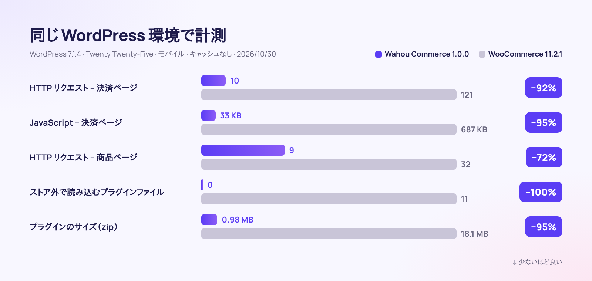

<div align="center">


[🇫🇷 Français](README.md) · [🇬🇧 English](README.en.md) · [🇪🇸 Español](README.es.md) · [🇮🇹 Italiano](README.it.md) · [🇩🇪 Deutsch](README.de.md) · **🇯🇵 日本語** · [🇵🇹 Português](README.pt.md)

<br>


### もっと売れて、もっと軽く、お客様を大切にする WordPress ストア。

**[⬇️ v1.0.0 をダウンロード](dist/wahou-commerce-1.0.0.zip)** · [🚀 5分で始める](#-5分で始める) · [🆚 WooCommerce と比較](#-wahou-commerce-vs-woocommerce) · [👤 作者について](#-作者--thierry-gustin)

</div>

---


## ✨ 概要

**Wahou Commerce** は、WordPress 向けのオールインワン EC プラグインです。月額料金も販売手数料もかけずに直接販売したい、**ヨーロッパのクリエイター、出版社、講師、スモールブランド**のために設計しました。

お客様の離脱を招き、販売者の時間を奪う「ストレスの種」を、ひとつずつ取り除いています。

- ⚡ **設計段階から高速**：ストア以外のページでは何も読み込みません。決済ページの JavaScript は WooCommerce の **20分の1** です。
- 📱 **親指操作を前提に設計**：決済は1ページで完結。Apple Pay と Google Pay に対応し、余計な入力欄はひとつもありません。
- 🇪🇺 **ヨーロッパ対応**：EU 27か国の VAT（付加価値税）、OSS（EU 域内の越境 B2C 販売の VAT を一括申告できる制度）、VAT 番号をリアルタイムで検証する B2B リバースチャージ（買い手側が VAT を申告する方式）、Omnibus 指令（セール時の価格表示などを定めた EU の消費者保護ルール）、デジタル商品の撤回権（クーリングオフに相当）に対応しています。
- 🤖 **AI に見つけてもらえる**：`llms.txt`、Markdown 版の商品ページ、充実した構造化データに加え、AI 購買エージェント向けの WordPress abilities を備えています。
- 💸 **自動で売上アップ**：order bump、ワンクリック upsell、カゴ落ちリマインド、ダイレクト購入リンクを搭載しています。

## 📊 数字で見る



<table>
<tr>
<td align="center" width="33%"><h3>−95%</h3>決済ページの JavaScript</td>
<td align="center" width="33%"><h3>0</h3>ストア外で読み込むファイル</td>
<td align="center" width="33%"><h3>0.98 MB</h3>プラグイン全体のサイズ</td>
</tr>
<tr>
<td align="center"><h3>27</h3>か国の VAT 税率を出典付きで内蔵</td>
<td align="center"><h3>3</h3>言語を同梱（翻訳済みテキスト 1,802 件）</td>
<td align="center"><h3>7</h3>ステップでストアを公開</td>
</tr>
</table>

<details>
<summary><b>測定方法</b></summary>

2026年10月30日に、同一構成の2つの環境で計測しました。WordPress 7.1.4、テーマは Twenty Twenty-Five、設定はデフォルトのまま、商品も同一、決済ゲートウェイは未接続、モバイルブラウザ（390 px）でキャッシュは空の状態です。比較したのは Wahou Commerce 1.0.0 と WooCommerce 11.2.1（最新の安定版）です。JavaScript はページ全体（WordPress、テーマ、プラグイン）を対象に、圧縮後（gzip）のサイズを KB 単位で計測しています。

| ページ | リクエスト数（Wahou / Woo） | JavaScript（Wahou / Woo） | プラグインのファイル数（Wahou / Woo） |
|---|---|---|---|
| トップページ（ストア外） | 4 / 19 | 17 KB / 69 KB | 0 / 11 |
| 商品一覧 | 10 / 31 | 26 KB / 77 KB | 2 / 20 |
| 商品ページ | 9 / 32 | 26 KB / 96 KB | 2 / 23 |
| 決済ページ | 10 / 121 | 33 KB / 687 KB | 4 / 30 |

ローカル環境のデモストアでは、商品ページの LCP が 0.2 秒、CLS が 0 でした。
</details>

## 🆚 Wahou Commerce vs WooCommerce

WooCommerce は業界のスタンダードであり、そのエコシステムは非常に大規模です。Wahou Commerce は別の道を選びました。**ヨーロッパの EC に欠かせない機能をすべて、ひとつの軽量プラグインに**。

| | **Wahou Commerce 1.0** | WooCommerce 11.2.1 単体 |
|---|:---:|:---:|
| プラグインのサイズ（zip） | **0.98 MB** | 18.1 MB |
| ストア外のページで読み込むファイル | **0** | 11 |
| 決済ページのリクエスト数 | **10** | 121 |
| Stripe、Apple Pay、Google Pay、PayPal | ✅ Webhook を自動設定 | ➕ |
| 27か国の VAT 税率 + OSS | ✅ | ⚙️ 税率は手入力 |
| VAT 番号の検証（VIES：EU の VAT 番号照会システム）+ B2B リバースチャージ | ✅ | ➕ ¹ |
| Omnibus 指令の参照価格（30日間） | ✅ | ➕ |
| 撤回権放棄の同意チェックボックス（デジタル商品） | ✅ | ➕ |
| カゴ落ちリマインド | ✅ メール3通 + クーポン | ➕ |
| ワンクリックの order bump、upsell、downsell | ✅ | ➕ |
| 連番付きの請求書とクレジットノート（返金伝票） | ✅ | ➕ |
| パスワード不要の顧客アカウント | ✅ マジックリンク | ⚙️ パスワード |
| AI 向けの `llms.txt` と Markdown 版商品ページ | ✅ | ➕ |
| Google Merchant Center 用フィード | ✅ | ➕ |
| プラグインとテーマのエコシステム | 🌱 まだ若いプロジェクト | ✅ 非常に大規模 |
| サブスクリプション、多通貨 | 🗺️ ロードマップに掲載 | ➕ |

✅ 標準搭載 · ⚙️ 可能だが手動 · ➕ 追加プラグインが必要 · 🗺️ 対応予定

¹ VAT 番号の収集と検証には、WooCommerce 自身が自社の拡張機能 [EU VAT Number](https://woocommerce.com/products/eu-vat-number/) を推奨しています。各機能の有無は、2026年10月30日に WooCommerce 11.2.1 のソースコードで確認しました。

## 📱 購入までの流れ


| 1. 商品一覧 | 2. 商品ページ | 3. 決済 | 4. 注文完了 |
|---|---|---|---|
| カテゴリー別の絞り込み、並べ替え、誠実なセールバッジ、クイック追加。 | Omnibus 指令に準拠した取り消し線価格、おすすめポイント、購入確認済みレビュー、即時購入。 | 1ページで完結。まずメールアドレス、住所は必要なときだけ。 | 即時ダウンロード、振込先口座の案内、パスワード不要のアカウント作成。 |

## 🧰 標準搭載の機能一覧

<table>
<tr>
<td width="50%" valign="top">

### 🛍️ カタログ
- 物理商品、デジタル商品、サービス
- 価格・在庫・SKU・画像を個別に設定できるバリエーション
- 固定価格または割引率で設定できるバンドル
- カスタマーレビューと購入確認済みバッジ
- 商品ごとの FAQ、おすすめポイント、仕様表

</td>
<td width="50%" valign="top">

### 💸 コンバージョン
- 送料無料バー付きのカートドロワー
- モバイルで画面に追従する購入バー
- ワンクリックの order bump、upsell、downsell
- 割引付きの「よく一緒に購入されている商品」
- ダイレクト購入リンクと URL で適用できるクーポンコード

</td>
</tr>
<tr>
<td valign="top">

### ✉️ カゴ落ち対策
- 入力された時点でメールアドレスを取得（同意を得たうえで）
- スケジュール設定できる3通のリマインド（1時間後、24時間後、72時間後）
- 1回限り使える個人専用クーポン
- 購入再開リンクとワンクリック配信停止
- 統計：回収率と回収した売上

</td>
<td valign="top">

### 💳 決済
- Stripe：カード、Apple Pay、Google Pay、Link
- PayPal（分割払いにも対応）
- 在庫を確保したうえでの銀行振込
- 管理画面からの返金とクレジットノート発行
- 無料注文（100% クーポン）

</td>
</tr>
<tr>
<td valign="top">

### 🇪🇺 VAT & コンプライアンス
- 27か国対応、書籍・電子書籍の税率も網羅
- OSS、VIES、VAT 適用外地域（カナリア諸島、フランス海外県）
- 30日間の Omnibus 参照価格
- デジタル商品の撤回権に適切に対応
- GDPR：データのエクスポートと削除

</td>
<td valign="top">

### 🤖 SEO & GEO
- JSON-LD：Product、Offer、レビュー、FAQ、パンくずリスト
- `llms.txt`、`llms-full.txt`、`.md` 形式の商品ページ
- Google Merchant Center 用フィード
- AI エージェント向けの WordPress abilities
- AI クローラー向けに調整できる robots.txt

</td>
</tr>
<tr>
<td valign="top">

### 🌍 多言語対応
- フランス語・スペイン語・英語を同梱
- 価格と国名を訪問者の言語で表示
- WPML・Polylang に対応、在庫は言語間で共有
- 注文時の言語でメールを送信

</td>
<td valign="top">

### 🧭 管理画面 & セットアップ
- 7ステップのセットアップウィザード
- ダッシュボード：売上、平均注文額、売れ筋商品
- 会計用 CSV エクスポート（税率別の VAT）
- WooCommerce からの商品インポート

</td>
</tr>
</table>

## 🖥️ わかりやすい管理画面


<table>
<tr>
<td width="50%"><br><sub><b>ウィザード</b>：キーを貼り付けて Stripe と PayPal に接続。</sub></td>
<td width="50%"><br><sub><b>商品エディター</b>：タブで整理されたひとつのフォームで、商品のすべてを編集。</sub></td>
</tr>
<tr>
<td><br><sub><b>VAT</b>：27か国の税率を、国ごとに変更可能。</sub></td>
<td><br><sub><b>カゴ落ち</b>：リマインドと回収した売上。</sub></td>
</tr>
</table>

## ✉️ 信頼感を高めるメール


注文確認メールには、ダウンロードリンク、VAT の内訳、請求書、法的な同意内容の確認が含まれます。メールは注文時の言語で送信されます。

## 🚀 5分で始める

1. [`wahou-commerce-1.0.0.zip`](dist/wahou-commerce-1.0.0.zip) を**ダウンロード**し、WordPress の **プラグイン → 新規追加 → アップロード** から追加します。
2. **有効化**するとウィザードが起動し、7つのステップ（事業内容、VAT、決済、配送、デザイン、ページ、公開）を順にご案内します。
3. [Stripe](https://dashboard.stripe.com/apikeys) と [PayPal](https://developer.paypal.com/dashboard/applications) の両方、またはどちらか一方の**キーを貼り付け**ます。Webhook と Apple Pay のドメインは自動で設定されます。
4. テストモードで注文を**テスト**してから、本番環境に切り替えます。

動作要件：WordPress 6.5 以降、PHP 8.1 以降。実際の決済には HTTPS が必要です。

<details>
<summary><b>高度な設定（wp-config.php、nginx）</b></summary>

```php
define( 'WAHOU_STRIPE_LIVE_SECRET', 'sk_live_...' );   // 定数はデータベースの値より優先されます
define( 'WAHOU_PAYPAL_LIVE_SECRET', '...' );
define( 'WAHOU_ENCRYPTION_KEY', 'a-long-random-string' ); // シークレットの暗号化キー
define( 'WAHOU_TRUST_PROXY', true );                  // Cloudflare やプロキシの背後で運用する場合
```

```nginx
location ~* /wp-content/uploads/(wahou-private|wahou-logs)/ { deny all; }
```
</details>

## 🔗 どこにでも置ける購入リンク

リンクを共有するだけで、お客様は決済ページへ直行します。Instagram のプロフィール、ニュースレター、QR コード、電子書籍の最終ページなどに最適です。

```text
https://your-store.jp/?wahou_buy=123                     → 商品 123 を直接決済
https://your-store.jp/?wahou_buy=123&wahou_coupon=LAUNCH → クーポンコードを適用して決済
https://your-store.jp/?wahou_add=123                     → カートに追加
```

## 🤖 AI 検索（GEO）に対応

AI アシスタントは JavaScript の読み取りが苦手です。そこで Wahou Commerce では、**すべてのコンテンツをサーバーサイドでレンダリング**し、各ストアが次の情報を自動で公開します。

- `/llms.txt`：AI 向けにまとめたストアの概要（商品、配送、返品、支払い）
- `/product/my-product.md`：各商品ページの Markdown 版（`rel="alternate"` でリンク）
- **充実した JSON-LD**：税込価格、在庫状況、返品ポリシー、送料と配送日数、レビュー、FAQ
- **WordPress abilities**（6.9 以降）：商品検索、商品詳細、ストア情報、決済リンク。MCP アダプター経由で AI エージェントから利用できます。

```markdown
# Wahou ストア

- 通貨: EUR
- 配送（フランス）: 2〜3営業日、4.90 €、50.00 €以上で送料無料
- 返品: 物理商品は配達後14日以内

## 商品
- [カクテル・ガイド（電子書籍）](https://wahou-store.jp/product/cocktail-guide-ebook.md): 120のシグネチャーレシピ。– 14.90 €（税込）
```

## 🇪🇺 EU 規制への準拠（2026年10月30日に確認）

| ルール | Wahou Commerce の対応 | 出典 |
|---|---|---|
| OSS の基準額 10,000 € | 基準額未満は販売者の国の VAT、OSS を選択した場合は顧客の国の VAT を適用 | Directive 2006/112/CE art. 59 quater（EU VAT 指令）、[欧州委員会 – OSS](https://vat-one-stop-shop.ec.europa.eu/one-stop-shop_en) |
| EU 加盟27か国の税率 | 税率表を内蔵（標準税率、軽減税率、書籍、電子書籍）、編集も可能 | [TEDB（欧州委員会）](https://ec.europa.eu/taxation_customs/tedb/) |
| VAT 適用外地域（カナリア諸島、セウタ、メリリャ、フランス海外県など）、モナコはフランス扱い | 国と郵便番号で判定 | Directive 2006/112/CE art. 6 et 7 |
| B2B リバースチャージ | [VIES](https://ec.europa.eu/taxation_customs/vies/) で VAT 番号をリアルタイムに検証し、請求書に法定の記載を追加 | Directive art. 196 et 138（EU VAT 指令） |
| 販売者の国の請求書記載事項 | ES：« Inversión del sujeto pasivo »（リバースチャージ）／FR：« Autoliquidation »（リバースチャージ）、« TVA non applicable, art. 293 B du CGI »（小規模事業者の VAT 免税） | [RD 1619/2012](https://www.boe.es/eli/es/rd/2012/11/30/1619)（スペイン請求書規則）、[CGI](https://www.legifrance.gouv.fr/codes/article_lc/LEGIARTI000050811276)（フランス租税一般法典） |
| セール時の参照価格 | 取り消し線価格 = 値下げ前30日間の最低価格 | [C. conso. L112-1-1](https://www.legifrance.gouv.fr/codes/article_lc/LEGIARTI000044549592)（フランス消費法典）、[Ley 7/1996 art. 20](https://www.boe.es/buscar/act.php?id=BOE-A-1996-1072#a20)（スペイン小売商業法）、CJEU C-330/23（EU 司法裁判所判決） |
| デジタルコンテンツと撤回権 | 初期状態で未チェックの必須チェックボックス + メールでの再通知 | Directive 2011/83/UE art. 16 m)（消費者権利指令）、[C. conso. L221-28](https://www.legifrance.gouv.fr/codes/article_lc/LEGIARTI000044563170) |
| 支払い義務を明示した注文ボタン | « Payer maintenant – 49,90 € »（ボタン文言は変更可能） | Directive 2011/83/UE art. 8(2)、[C. conso. L221-14](https://www.legifrance.gouv.fr/codes/article_lc/LEGIARTI000032226854) |
| アクセシビリティ（EAA：欧州アクセシビリティ法） | キーボード操作、スクリーンリーダー、コントラスト、モーション軽減に対応 | Directive (UE) 2019/882（2025年6月28日から適用） |

<details>
<summary><b>⚠️ 決済を受け付ける前に知っておきたいこと</b></summary>

- **スペイン – VERI\*FACTU**（スペインの請求書発行システム規制）：本プラグインが発行する請求書は VERI\*FACTU 形式ではありません。適用開始日は、法人が 2027年1月1日、個人事業主（autónomos）が 2027年7月1日です（スペイン勅令法 [RDL 15/2025](https://www.boe.es/buscar/doc.php?id=BOE-A-2025-24446)）。2026年10月5日に 2028年10月への延期が発表されましたが、まだ BOE（スペイン官報）には公布されていません（[Hacienda（スペイン財務省）の通知](https://www.hacienda.gob.es/sgt/gabsehacienda/nota-informativa-verifactu.pdf)）。
- **フランス – 電子インボイス**：2026年9月1日から受信が義務化されています。中小企業・零細企業の場合、発行と e-reporting（取引データの電子報告）は遅くとも 2027年9月1日に義務化されます（[impots.gouv.fr](https://www.impots.gouv.fr/professionnel/je-passe-la-facturation-electronique)）。会計用 CSV エクスポートが対応のベースになります。
- **OSS 2027**：10,000 € の基準額の算定方法が 2027年1月1日に変わります（EU VAT 指令の改正指令 [Directive 2025/516](https://eur-lex.europa.eu/eli/dir/2025/516/oj)）。
- 未対応の地方税：IGIC（カナリア諸島）、IPSI（セウタ、メリリャ）、octroi de mer（フランス海外県）。
</details>

## 🛡️ セキュリティ

- シークレットはデータベース内で暗号化して保存し（libsodium）、定数で上書きすることもできます。
- Stripe の Webhook は署名（HMAC-SHA256）を、PayPal の Webhook は PayPal API を使って検証します。
- 金額は常にサーバー側で再計算し、実際に受け取った支払額と照合します。
- デジタルファイルはメディアライブラリの外に保管し、有効期限と使用回数を制限したトークンで配信します。
- すべての操作で nonce と権限（capability）をチェックし、専用のロールを用意しています。「カードテスト」攻撃にはレート制限で対策しています。

## 🧑‍💻 開発者向け

- テンプレートは `your-theme/wahou-commerce/` に配置して上書きできます。
- REST API `wahou/v1`（カート、決済、注文、商品）とフックは [`docs/ARCHITECTURE.md`](docs/ARCHITECTURE.md) で解説しています。
- WP-CLI：`wp wahou status`、`wp wahou cron`、`wp wahou pages`。
- `bin/build.sh` で minify 済みファイルと zip を生成します。`SCRIPT_DEBUG` を有効にすると、読みやすいソースが配信されます。
- 実行時の Composer・npm 依存はゼロ。ストア側では jQuery を一切使用しません。

## 🗺️ ロードマップ

- サブスクリプション（Stripe Billing）と多通貨対応
- ファセット検索フィルターと再入荷通知
- VERI\*FACTU 対応の請求書（スペイン）と認定プラットフォームへの送信（フランス）
- PDF/EPUB の電子透かしとライセンスキー

## 👤 作者 — Thierry Gustin

<table>
<tr>
<td valign="top">

私、Thierry Gustin（ティエリー・ギュスタン）は、マドリードに暮らして14年になるフランス人で、独立した起業家として活動しています。出版社 **Éditions Olibook** では、6か国語で約200冊の本を刊行してきました（人工知能、カクテル、ガーデニングなどをテーマにした「バイブル」シリーズもそのひとつです）。また、[**GustinAI**](https://gustinai.com)（フランスとスペインの企業向け AI 研修）と [**DelfOnline**](https://delfonline.es)（フランス語試験 DELF・DALF・TCF の対策）の創業者でもあります。

Wahou Commerce は、もともと私自身のために作ったものです。**ヨーロッパ全域で、月額料金も手数料もなしに直接販売したい。しかも、そのために夜の時間を削ることなく。**

**コードに込めた、私の価値観：**

- 🕊️ **徹底したシンプルさ**：入力欄ひとつ、クリックひとつを減らすことに意味があります。
- ⏱️ **何よりも時間を大切に**：自動化できることは、すべて自動化しています（リマインド、請求書、VAT）。
- 🤝 **お客様への敬意**：偽のカウンターも見せかけの緊急性も使わず、価格は明快に表示します。
- ⚖️ **透明性**：ルールは検証し、出典を明記し、限界も包み隠さずお伝えします。
- 🌍 **多言語のヨーロッパ**：最初からフランス、スペイン、そして EU 全体のために設計しています。
- 🔓 **独立性**：顧客も、データも、ストアも、すべてあなたのもの。自由ソフトウェアとして提供しています。

[🌐 gustinai.com](https://gustinai.com) · [📚 delfonline.es](https://delfonline.es) · [💻 GitHub @Jacckisback](https://github.com/Jacckisback)

</td>
</tr>
</table>

## 📄 ライセンス

[GPL-2.0-or-later](LICENSE) © Thierry Gustin。自由に利用、改変、再配布できます。

<div align="center">

**Wahou Commerce で時間を節約できたら、ぜひ GitHub で ⭐ をお願いします！**

</div>
