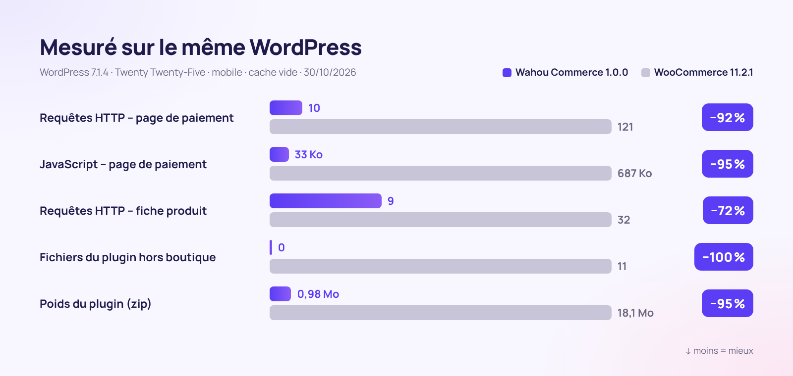

<div align="center">


**🇫🇷 Français** · [🇬🇧 English](README.en.md) · [🇪🇸 Español](README.es.md) · [🇮🇹 Italiano](README.it.md) · [🇩🇪 Deutsch](README.de.md) · [🇯🇵 日本語](README.ja.md) · [🇵🇹 Português](README.pt.md)

<br>


### La boutique WordPress qui vend plus, charge moins et respecte vos clients.

**[⬇️ Télécharger la v1.0.0](dist/wahou-commerce-1.0.0.zip)** · [🚀 Démarrer en 5 minutes](#-démarrer-en-5-minutes) · [🆚 Comparer avec WooCommerce](#-wahou-commerce-vs-woocommerce) · [👤 L'auteur](#-lauteur--thierry-gustin)

</div>

---


## ✨ En bref

**Wahou Commerce** est une extension e-commerce complète pour WordPress, pensée pour les **créateurs, éditeurs, formateurs et petites marques européennes** qui veulent vendre en direct, sans abonnement ni commission sur leurs ventes.

Elle supprime un à un les points de friction qui font fuir les clients et perdre du temps aux vendeurs :

- ⚡ **Rapide par construction** : rien n'est chargé hors de la boutique, et la page de paiement pèse **20 fois moins de JavaScript** que celle de WooCommerce.
- 📱 **Pensée pour le pouce** : paiement sur une seule page, Apple Pay et Google Pay, aucun champ inutile.
- 🇪🇺 **Prête pour l'Europe** : TVA des 27 pays, OSS, autoliquidation B2B vérifiée en direct, règles Omnibus et droit de rétractation numérique.
- 🤖 **Visible des IA** : `llms.txt`, fiches Markdown, données structurées complètes et abilities WordPress pour les agents d'achat.
- 💸 **Vendre plus, automatiquement** : order bump, upsell en un clic, relances de paniers abandonnés et liens d'achat direct.

## 📊 Les chiffres



<table>
<tr>
<td align="center" width="33%"><h3>−95 %</h3>de JavaScript sur la page de paiement</td>
<td align="center" width="33%"><h3>0</h3>fichier chargé hors de la boutique</td>
<td align="center" width="33%"><h3>0,98 Mo</h3>pour l'extension complète</td>
</tr>
<tr>
<td align="center"><h3>27</h3>pays de TVA intégrés et sourcés</td>
<td align="center"><h3>3</h3>langues incluses (1 802 textes traduits)</td>
<td align="center"><h3>7</h3>étapes pour lancer la boutique</td>
</tr>
</table>

<details>
<summary><b>Méthode de mesure</b></summary>

Mesures faites le 30/10/2026 sur deux installations identiques : WordPress 7.1.4, thème Twenty Twenty-Five, réglages par défaut, mêmes produits, aucune passerelle de paiement connectée, navigateur mobile (390 px) à cache vide. Wahou Commerce 1.0.0 comparé à WooCommerce 11.2.1 (dernière version stable). Le JavaScript est compté en Ko compressés (gzip) pour toute la page : WordPress, thème et extension.

| Page | Requêtes (Wahou / Woo) | JavaScript (Wahou / Woo) | Fichiers de l'extension (Wahou / Woo) |
|---|---|---|---|
| Accueil (hors boutique) | 4 / 19 | 17 Ko / 69 Ko | 0 / 11 |
| Catalogue | 10 / 31 | 26 Ko / 77 Ko | 2 / 20 |
| Fiche produit | 9 / 32 | 26 Ko / 96 Ko | 2 / 23 |
| Paiement | 10 / 121 | 33 Ko / 687 Ko | 4 / 30 |

Sur la boutique de démonstration, en local : LCP d'une fiche produit de 0,2 s, CLS de 0.
</details>

## 🆚 Wahou Commerce vs WooCommerce

WooCommerce est une référence et son écosystème est immense. Wahou Commerce fait un autre choix : **tout l'essentiel du e-commerce européen inclus, dans une extension légère**.

| | **Wahou Commerce 1.0** | WooCommerce 11.2.1 seul |
|---|:---:|:---:|
| Poids de l'extension (zip) | **0,98 Mo** | 18,1 Mo |
| Fichiers chargés sur une page hors boutique | **0** | 11 |
| Requêtes sur la page de paiement | **10** | 121 |
| Stripe, Apple Pay, Google Pay et PayPal | ✅ webhooks configurés automatiquement | ➕ |
| Taux de TVA des 27 pays + OSS | ✅ | ⚙️ taux à saisir |
| Numéro de TVA vérifié (VIES) + autoliquidation B2B | ✅ | ➕ ¹ |
| Prix de référence Omnibus (30 jours) | ✅ | ➕ |
| Case de renonciation au droit de rétractation (numérique) | ✅ | ➕ |
| Relances de paniers abandonnés | ✅ 3 e-mails + coupon | ➕ |
| Order bump, upsell et downsell en 1 clic | ✅ | ➕ |
| Factures et avoirs numérotés | ✅ | ➕ |
| Comptes clients sans mot de passe | ✅ lien magique | ⚙️ mot de passe |
| `llms.txt` et fiches Markdown pour les IA | ✅ | ➕ |
| Flux Google Merchant Center | ✅ | ➕ |
| Écosystème d'extensions et de thèmes | 🌱 jeune projet | ✅ immense |
| Abonnements, multidevise | 🗺️ feuille de route | ➕ |

✅ inclus · ⚙️ possible, mais manuel · ➕ nécessite une extension · 🗺️ prévu

¹ WooCommerce recommande lui-même son extension [EU VAT Number](https://woocommerce.com/products/eu-vat-number/) pour collecter et valider les numéros de TVA. Fonctionnalités vérifiées dans le code source de WooCommerce 11.2.1 le 30/10/2026.

## 📱 Le parcours d'achat


| 1. Catalogue | 2. Fiche produit | 3. Paiement | 4. Confirmation |
|---|---|---|---|
| Filtres par catégorie, tri, badges promo honnêtes, ajout rapide. | Prix barré conforme Omnibus, points forts, avis vérifiés, achat immédiat. | Une seule page, e-mail d'abord, adresse seulement si nécessaire. | Téléchargements immédiats, coordonnées bancaires, compte créé sans mot de passe. |

## 🧰 Tout ce qui est inclus

<table>
<tr>
<td width="50%" valign="top">

### 🛍️ Catalogue
- Produits physiques, numériques et services
- Variantes avec prix, stock, SKU et image
- Bundles à prix fixe ou en pourcentage
- Avis clients, badge « achat vérifié »
- FAQ produit, points forts, fiche technique

</td>
<td width="50%" valign="top">

### 💸 Conversion
- Tiroir panier avec barre « livraison offerte »
- Barre d'achat collante sur mobile
- Order bump, upsell et downsell en 1 clic
- « Souvent achetés ensemble » avec remise
- Liens d'achat direct et codes promo par URL

</td>
</tr>
<tr>
<td valign="top">

### ✉️ Paniers abandonnés
- E-mail capturé dès sa saisie, avec consentement
- 3 relances programmables (1 h, 24 h, 72 h)
- Coupon personnel à usage unique
- Lien de reprise et désinscription en 1 clic
- Statistiques : taux et CA récupérés

</td>
<td valign="top">

### 💳 Paiements
- Stripe : cartes, Apple Pay, Google Pay, Link
- PayPal, avec paiement en plusieurs fois
- Virement bancaire avec stock réservé
- Remboursements depuis l'admin, avec avoir
- Commandes gratuites (coupon 100 %)

</td>
</tr>
<tr>
<td valign="top">

### 🇪🇺 TVA & conformité
- 27 pays, livres et e-books compris
- OSS, VIES, territoires hors TVA (Canaries, DOM)
- Prix de référence Omnibus sur 30 jours
- Droit de rétractation numérique encadré
- RGPD : export et effacement des données

</td>
<td valign="top">

### 🤖 SEO & GEO
- JSON-LD : Product, Offer, avis, FAQ, fil d'Ariane
- `llms.txt`, `llms-full.txt` et fiches `.md`
- Flux Google Merchant Center
- Abilities WordPress pour les agents IA
- robots.txt réglable pour les robots IA

</td>
</tr>
<tr>
<td valign="top">

### 🌍 Multilingue
- Français, espagnol et anglais inclus
- Prix et pays affichés dans la langue du visiteur
- WPML et Polylang, stock partagé
- E-mails dans la langue de la commande

</td>
<td valign="top">

### 🧭 Admin & démarrage
- Assistant de démarrage en 7 étapes
- Tableau de bord : CA, panier moyen, top ventes
- Export comptable CSV (TVA par taux)
- Import des produits WooCommerce

</td>
</tr>
</table>

## 🖥️ Une administration claire


<table>
<tr>
<td width="50%"><br><sub><b>Assistant</b> : Stripe et PayPal connectés en collant vos clés.</sub></td>
<td width="50%"><br><sub><b>Éditeur de produit</b> : tout le produit dans un seul formulaire, par onglets.</sub></td>
</tr>
<tr>
<td><br><sub><b>TVA</b> : taux des 27 pays, modifiables pays par pays.</sub></td>
<td><br><sub><b>Paniers abandonnés</b> : relances et chiffre d'affaires récupéré.</sub></td>
</tr>
</table>

## ✉️ Des e-mails qui inspirent confiance


Confirmation avec liens de téléchargement, TVA détaillée, facture et rappel des consentements légaux. Les e-mails partent dans la langue de la commande.

## 🚀 Démarrer en 5 minutes

1. **Téléchargez** [`wahou-commerce-1.0.0.zip`](dist/wahou-commerce-1.0.0.zip), puis dans WordPress : **Extensions → Ajouter → Téléverser**.
2. **Activez** : l'assistant s'ouvre et vous guide en 7 étapes (activité, TVA, paiements, livraison, design, pages, lancement).
3. **Collez vos clés** [Stripe](https://dashboard.stripe.com/apikeys) et/ou [PayPal](https://developer.paypal.com/dashboard/applications) : webhooks et domaine Apple Pay sont configurés pour vous.
4. **Testez** une commande en mode test, puis passez en production.

Prérequis : WordPress 6.5 ou plus récent, PHP 8.1 ou plus, et HTTPS pour les paiements réels.

<details>
<summary><b>Réglages avancés (wp-config.php, nginx)</b></summary>

```php
define( 'WAHOU_STRIPE_LIVE_SECRET', 'sk_live_...' );   // les constantes sont prioritaires sur la base
define( 'WAHOU_PAYPAL_LIVE_SECRET', '...' );
define( 'WAHOU_ENCRYPTION_KEY', 'une-longue-chaine-aleatoire' ); // clé de chiffrement des secrets
define( 'WAHOU_TRUST_PROXY', true );                  // derrière Cloudflare ou un proxy
```

```nginx
location ~* /wp-content/uploads/(wahou-private|wahou-logs)/ { deny all; }
```
</details>

## 🔗 Des liens d'achat partout

Partagez un lien et le client arrive directement au paiement : idéal pour une bio Instagram, une newsletter, un QR code ou la dernière page d'un e-book.

```text
https://votre-boutique.fr/?wahou_buy=123                        → paiement direct du produit 123
https://votre-boutique.fr/?wahou_buy=123&wahou_coupon=LANCEMENT → avec code promo appliqué
https://votre-boutique.fr/?wahou_add=123                        → ajout au panier
```

## 🤖 Prête pour la recherche par IA (GEO)

Les assistants IA lisent mal le JavaScript : chez Wahou Commerce, **tout le contenu est rendu côté serveur** et chaque boutique publie automatiquement :

- `/llms.txt` : votre boutique résumée pour les IA (produits, livraison, retours, paiement) ;
- `/produit/mon-produit.md` : chaque fiche en Markdown, liée par `rel="alternate"` ;
- un **JSON-LD complet** : prix TTC, disponibilité, politique de retour, frais et délais de livraison, avis, FAQ ;
- des **abilities WordPress** (6.9+) : recherche de produits, fiche, infos boutique et lien de paiement, utilisables par un agent via l'adaptateur MCP.

```markdown
# Boutique Wahou

- Devise : EUR
- Livraison (France) : 2 à 3 jours ouvrés, 4,90 €, gratuite dès 50,00 €
- Retours : 14 jours après la livraison pour les produits physiques

## Produits
- [Le Guide des Cocktails (e-book)](https://boutique-wahou.fr/produit/guide-des-cocktails-ebook.md): 120 recettes signature. – 14,90 € TTC
```

## 🇪🇺 Conformité européenne (vérifiée le 30/10/2026)

| Règle | Ce que fait Wahou Commerce | Source |
|---|---|---|
| Seuil OSS de 10 000 € | TVA du pays du vendeur sous le seuil, du pays du client avec l'option OSS | Directive 2006/112/CE art. 59 quater ; [Commission – OSS](https://vat-one-stop-shop.ec.europa.eu/one-stop-shop_en) |
| Taux des 27 États membres | Table intégrée (normal, réduits, livres, e-books), modifiable | [TEDB, Commission européenne](https://ec.europa.eu/taxation_customs/tedb/) |
| Territoires hors TVA (Canaries, Ceuta, Melilla, DOM…), Monaco = France | Détection par pays et code postal | Directive 2006/112/CE art. 6 et 7 |
| Autoliquidation B2B | Numéro vérifié en direct sur [VIES](https://ec.europa.eu/taxation_customs/vies/), mention légale sur la facture | Directive art. 196 et 138 |
| Mentions de facture du pays du vendeur | ES : « Inversión del sujeto pasivo » ; FR : « Autoliquidation », « TVA non applicable, art. 293 B du CGI » | [RD 1619/2012](https://www.boe.es/eli/es/rd/2012/11/30/1619) ; [CGI](https://www.legifrance.gouv.fr/codes/article_lc/LEGIARTI000050811276) |
| Prix de référence des promotions | Prix barré = plus bas des 30 jours précédant la réduction | [C. conso. L112-1-1](https://www.legifrance.gouv.fr/codes/article_lc/LEGIARTI000044549592) ; [Ley 7/1996 art. 20](https://www.boe.es/buscar/act.php?id=BOE-A-1996-1072#a20) ; CJUE C-330/23 |
| Contenu numérique et droit de rétractation | Case non cochée obligatoire + rappel dans l'e-mail | Directive 2011/83/UE art. 16 m) ; [C. conso. L221-28](https://www.legifrance.gouv.fr/codes/article_lc/LEGIARTI000044563170) |
| Bouton de commande explicite | « Payer maintenant – 49,90 € » (libellé modifiable) | Directive 2011/83/UE art. 8(2) ; [C. conso. L221-14](https://www.legifrance.gouv.fr/codes/article_lc/LEGIARTI000032226854) |
| Accessibilité (EAA) | Navigation clavier, lecteurs d'écran, contrastes, mouvements réduits | Directive (UE) 2019/882, applicable depuis le 28/06/2025 |

<details>
<summary><b>⚠️ À savoir avant d'encaisser</b></summary>

- **Espagne – VERI\*FACTU** : les factures du plugin ne sont pas au format VERI\*FACTU. Dates en vigueur : 1er janvier 2027 (sociétés) et 1er juillet 2027 (autónomos) ([RDL 15/2025](https://www.boe.es/buscar/doc.php?id=BOE-A-2025-24446)). Un report à octobre 2028 a été annoncé le 05/10/2026 mais n'est pas encore publié au BOE ([note Hacienda](https://www.hacienda.gob.es/sgt/gabsehacienda/nota-informativa-verifactu.pdf)).
- **France – facturation électronique** : réception obligatoire depuis le 1er septembre 2026 ; émission et e-reporting au plus tard le 1er septembre 2027 pour les PME et microentreprises ([impots.gouv.fr](https://www.impots.gouv.fr/professionnel/je-passe-la-facturation-electronique)). L'export CSV comptable sert de base.
- **OSS 2027** : le calcul du seuil de 10 000 € change au 1er janvier 2027 ([Directive 2025/516](https://eur-lex.europa.eu/eli/dir/2025/516/oj)).
- Taxes locales non gérées : IGIC (Canaries), IPSI (Ceuta, Melilla), octroi de mer (DOM).
</details>

## 🛡️ Sécurité

- Secrets chiffrés en base (libsodium), surchargeables par constantes.
- Webhooks Stripe signés (HMAC-SHA256) et PayPal vérifiés par l'API PayPal.
- Montants toujours recalculés côté serveur et comparés au paiement reçu.
- Fichiers numériques hors médiathèque, servis par jetons à durée et usage limités.
- Nonces et capacités sur chaque action, rôles dédiés, limitation de débit contre le « card testing ».

## 🧑‍💻 Pour les développeurs

- Templates surchargeables dans `votre-theme/wahou-commerce/`.
- API REST `wahou/v1` (panier, paiement, commandes, produits) et hooks documentés dans [`docs/ARCHITECTURE.md`](docs/ARCHITECTURE.md).
- WP-CLI : `wp wahou status`, `wp wahou cron`, `wp wahou pages`.
- `bin/build.sh` génère les fichiers minifiés et le zip ; avec `SCRIPT_DEBUG`, les sources lisibles sont servies.
- Aucune dépendance Composer ni npm à l'exécution, aucun jQuery côté boutique.

## 🗺️ Feuille de route

- Abonnements (Stripe Billing) et multidevise
- Filtres à facettes et alertes de retour en stock
- Factures VERI\*FACTU (Espagne) et transmission à une plateforme agréée (France)
- Tatouage numérique des PDF/EPUB et clés de licence

## 👤 L'auteur — Thierry Gustin

<table>
<tr>
<td valign="top">

Français installé à Madrid depuis 14 ans et trilingue (français, espagnol, anglais), je suis entrepreneur indépendant et fondateur de **[GustinAI](https://gustinai.com)** (formations IA pour les entreprises en France et en Espagne).

J'ai créé Wahou Commerce pour mes propres besoins : **vendre en direct, partout en Europe, sans abonnement ni commission, et sans y passer mes soirées.**

**Mes valeurs, traduites dans le code :**

- 🕊️ **Simplicité radicale** : chaque champ et chaque clic en moins compte.
- ⏱️ **Le temps avant tout** : tout ce qui peut s'automatiser l'est (relances, factures, TVA).
- 🤝 **Respect du client** : pas de faux compteurs ni de fausse urgence, des prix clairs.
- ⚖️ **Transparence** : règles vérifiées, sources citées, limites assumées.
- 🌍 **Europe multilingue** : pensé dès le départ pour la France, l'Espagne et toute l'UE.
- 🔓 **Indépendance** : vos clients, vos données, votre boutique, en logiciel libre.

[🌐 gustinai.com](https://gustinai.com) · [💻 GitHub @Jacckisback](https://github.com/Jacckisback)

</td>
</tr>
</table>

## 📄 Licence

[GPL-2.0-or-later](LICENSE) © Thierry Gustin. Libre d'utilisation, de modification et de redistribution.

<div align="center">

**Si Wahou Commerce vous fait gagner du temps, laissez une ⭐ sur GitHub !**

</div>
