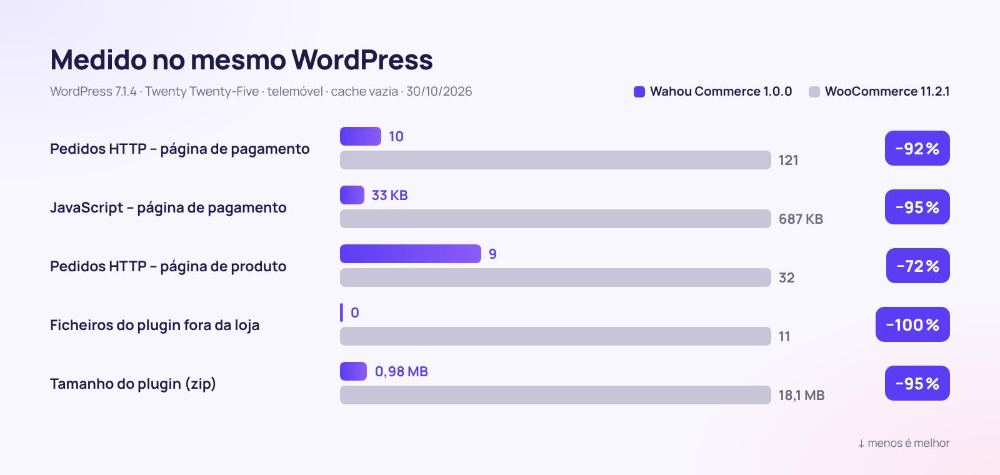

<div align="center">


[🇫🇷 Français](README.md) · [🇬🇧 English](README.en.md) · [🇪🇸 Español](README.es.md) · [🇮🇹 Italiano](README.it.md) · [🇩🇪 Deutsch](README.de.md) · [🇯🇵 日本語](README.ja.md) · **🇵🇹 Português**

<br>


### A loja WordPress que vende mais, carrega menos e respeita os seus clientes.

**[⬇️ Descarregar a v1.0.0](dist/wahou-commerce-1.0.0.zip)** · [🚀 Comece em 5 minutos](#-comece-em-5-minutos) · [🆚 Comparar com o WooCommerce](#-wahou-commerce-vs-woocommerce) · [👤 O autor](#-o-autor--thierry-gustin)

</div>

---


## ✨ Em resumo

O **Wahou Commerce** é um plugin de e-commerce completo para WordPress, pensado para **criadores, editores, formadores e pequenas marcas europeias** que querem vender diretamente, sem subscrições nem comissões sobre as vendas.

Elimina, um a um, os pontos de atrito que afastam os clientes e fazem os vendedores perder tempo:

- ⚡ **Rápido de raiz**: nada é carregado fora da loja e a página de pagamento usa **20 vezes menos JavaScript** do que a do WooCommerce.
- 📱 **Pensado para o polegar**: pagamento numa só página, Apple Pay e Google Pay, nenhum campo desnecessário.
- 🇪🇺 **Preparado para a Europa**: IVA dos 27 países, OSS, autoliquidação B2B verificada em tempo real, regras Omnibus e direito de livre resolução para conteúdos digitais.
- 🤖 **Visível para a IA**: `llms.txt`, páginas em Markdown, dados estruturados completos e abilities do WordPress para agentes de compra.
- 💸 **Vender mais, automaticamente**: order bump, upsell com um clique, lembretes de carrinhos abandonados e links de compra direta.

## 📊 Os números



<table>
<tr>
<td align="center" width="33%"><h3>−95 %</h3>de JavaScript na página de pagamento</td>
<td align="center" width="33%"><h3>0</h3>ficheiros carregados fora da loja</td>
<td align="center" width="33%"><h3>0,98 MB</h3>para o plugin completo</td>
</tr>
<tr>
<td align="center"><h3>27</h3>países com IVA integrado e fontes citadas</td>
<td align="center"><h3>3</h3>idiomas incluídos (1802 textos traduzidos)</td>
<td align="center"><h3>7</h3>passos para lançar a loja</td>
</tr>
</table>

<details>
<summary><b>Metodologia de medição</b></summary>

Medições efetuadas a 30/10/2026 em duas instalações idênticas: WordPress 7.1.4, tema Twenty Twenty-Five, definições por omissão, os mesmos produtos, nenhum gateway de pagamento ligado, navegador de telemóvel (390 px) com cache vazia. O Wahou Commerce 1.0.0 foi comparado com o WooCommerce 11.2.1 (última versão estável). O JavaScript é contabilizado em KB comprimidos (gzip) para a página inteira: WordPress, tema e plugin.

| Página | Pedidos HTTP (Wahou / Woo) | JavaScript (Wahou / Woo) | Ficheiros do plugin (Wahou / Woo) |
|---|---|---|---|
| Página inicial (fora da loja) | 4 / 19 | 17 KB / 69 KB | 0 / 11 |
| Catálogo | 10 / 31 | 26 KB / 77 KB | 2 / 20 |
| Página de produto | 9 / 32 | 26 KB / 96 KB | 2 / 23 |
| Pagamento | 10 / 121 | 33 KB / 687 KB | 4 / 30 |

Na loja de demonstração, em ambiente local: LCP de 0,2 s numa página de produto e CLS de 0.
</details>

## 🆚 Wahou Commerce vs WooCommerce

O WooCommerce é uma referência e o seu ecossistema é imenso. O Wahou Commerce faz outra escolha: **todo o essencial do e-commerce europeu, incluído num plugin leve**.

| | **Wahou Commerce 1.0** | WooCommerce 11.2.1 por si só |
|---|:---:|:---:|
| Tamanho do plugin (zip) | **0,98 MB** | 18,1 MB |
| Ficheiros carregados numa página fora da loja | **0** | 11 |
| Pedidos HTTP na página de pagamento | **10** | 121 |
| Stripe, Apple Pay, Google Pay e PayPal | ✅ webhooks configurados automaticamente | ➕ |
| Taxas de IVA dos 27 países + OSS | ✅ | ⚙️ taxas a introduzir |
| Número de IVA verificado (VIES) + autoliquidação B2B | ✅ | ➕ ¹ |
| Preço de referência Omnibus (30 dias) | ✅ | ➕ |
| Caixa de renúncia ao direito de livre resolução (conteúdo digital) | ✅ | ➕ |
| Lembretes de carrinhos abandonados | ✅ 3 e-mails + cupão | ➕ |
| Order bump, upsell e downsell com 1 clique | ✅ | ➕ |
| Faturas e notas de crédito numeradas | ✅ | ➕ |
| Contas de cliente sem palavra-passe | ✅ link mágico | ⚙️ palavra-passe |
| `llms.txt` e páginas em Markdown para IA | ✅ | ➕ |
| Feed do Google Merchant Center | ✅ | ➕ |
| Ecossistema de extensões e temas | 🌱 projeto jovem | ✅ imenso |
| Subscrições, multimoeda | 🗺️ no roteiro | ➕ |

✅ incluído · ⚙️ possível, mas manual · ➕ requer uma extensão · 🗺️ previsto

¹ O próprio WooCommerce recomenda a sua extensão [EU VAT Number](https://woocommerce.com/products/eu-vat-number/) para recolher e validar números de IVA. Funcionalidades verificadas no código-fonte do WooCommerce 11.2.1 a 30/10/2026.

## 📱 O percurso de compra


| 1. Catálogo | 2. Página de produto | 3. Pagamento | 4. Confirmação |
|---|---|---|---|
| Filtros por categoria, ordenação, etiquetas de promoção honestas, adição rápida ao carrinho. | Preço riscado em conformidade com a Omnibus, pontos fortes, avaliações verificadas, compra imediata. | Uma única página, e-mail primeiro, morada só quando necessária. | Downloads imediatos, dados bancários, conta criada sem palavra-passe. |

## 🧰 Tudo o que está incluído

<table>
<tr>
<td width="50%" valign="top">

### 🛍️ Catálogo
- Produtos físicos, digitais e serviços
- Variantes com preço, stock, SKU e imagem
- Pacotes (bundles) a preço fixo ou com desconto em percentagem
- Avaliações de clientes, selo «compra verificada»
- FAQ do produto, pontos fortes, ficha técnica

</td>
<td width="50%" valign="top">

### 💸 Conversão
- Carrinho em gaveta lateral com barra «portes grátis»
- Barra de compra fixa no telemóvel
- Order bump, upsell e downsell com 1 clique
- «Frequentemente comprados juntos» com desconto
- Links de compra direta e códigos promocionais por URL

</td>
</tr>
<tr>
<td valign="top">

### ✉️ Carrinhos abandonados
- E-mail captado assim que é introduzido, com consentimento
- 3 lembretes programáveis (1 h, 24 h, 72 h)
- Cupão pessoal de utilização única
- Link para retomar o carrinho e cancelar a subscrição com 1 clique
- Estatísticas: taxa de recuperação e faturação recuperada

</td>
<td valign="top">

### 💳 Pagamentos
- Stripe: cartões, Apple Pay, Google Pay, Link
- PayPal, com pagamento em prestações
- Transferência bancária com stock reservado
- Reembolsos a partir da administração, com nota de crédito
- Encomendas gratuitas (cupão de 100 %)

</td>
</tr>
<tr>
<td valign="top">

### 🇪🇺 IVA & conformidade
- 27 países, incluindo livros e e-books
- OSS, VIES, territórios fora do âmbito do IVA (Canárias, DOM franceses)
- Preço de referência Omnibus dos 30 dias anteriores
- Direito de livre resolução digital devidamente enquadrado
- RGPD: exportação e eliminação de dados

</td>
<td valign="top">

### 🤖 SEO & GEO
- JSON-LD: Product, Offer, avaliações, FAQ, breadcrumbs
- `llms.txt`, `llms-full.txt` e páginas `.md`
- Feed do Google Merchant Center
- Abilities do WordPress para agentes de IA
- robots.txt configurável para os crawlers de IA

</td>
</tr>
<tr>
<td valign="top">

### 🌍 Multilingue
- Francês, espanhol e inglês incluídos (traduções para português são bem-vindas)
- Preços e países apresentados no idioma do visitante
- WPML e Polylang, com stock partilhado
- E-mails no idioma da encomenda

</td>
<td valign="top">

### 🧭 Administração & primeiros passos
- Assistente de configuração em 7 passos
- Painel: faturação, valor médio por encomenda, mais vendidos
- Exportação contabilística em CSV (IVA por taxa)
- Importação de produtos do WooCommerce

</td>
</tr>
</table>

## 🖥️ Uma área de administração clara


<table>
<tr>
<td width="50%"><br><sub><b>Assistente</b>: para ligar o Stripe e o PayPal, basta colar as suas chaves.</sub></td>
<td width="50%"><br><sub><b>Editor de produto</b>: todo o produto num único formulário, organizado por separadores.</sub></td>
</tr>
<tr>
<td><br><sub><b>IVA</b>: taxas dos 27 países, editáveis país a país.</sub></td>
<td><br><sub><b>Carrinhos abandonados</b>: lembretes e faturação recuperada.</sub></td>
</tr>
</table>

## ✉️ E-mails que inspiram confiança


Confirmação com links de download, IVA discriminado, fatura e lembrete dos consentimentos legais. Os e-mails são enviados no idioma da encomenda.

## 🚀 Comece em 5 minutos

1. **Descarregue** [`wahou-commerce-1.0.0.zip`](dist/wahou-commerce-1.0.0.zip) e, no WordPress, vá a **Plugins → Adicionar plugin → Carregar plugin**.
2. **Ative**: o assistente abre-se e guia-o em 7 passos (atividade, IVA, pagamentos, envio, design, páginas, lançamento).
3. **Cole as suas chaves** do [Stripe](https://dashboard.stripe.com/apikeys) e/ou do [PayPal](https://developer.paypal.com/dashboard/applications): os webhooks e o domínio do Apple Pay ficam configurados automaticamente.
4. **Teste** uma encomenda em modo de teste e, depois, passe para produção.

Pré-requisitos: WordPress 6.5 ou mais recente, PHP 8.1 ou superior e HTTPS para pagamentos reais.

<details>
<summary><b>Definições avançadas (wp-config.php, nginx)</b></summary>

```php
define( 'WAHOU_STRIPE_LIVE_SECRET', 'sk_live_...' );   // as constantes têm prioridade sobre a base de dados
define( 'WAHOU_PAYPAL_LIVE_SECRET', '...' );
define( 'WAHOU_ENCRYPTION_KEY', 'uma-longa-cadeia-aleatoria' ); // chave de encriptação dos segredos
define( 'WAHOU_TRUST_PROXY', true );                  // atrás do Cloudflare ou de um proxy
```

```nginx
location ~* /wp-content/uploads/(wahou-private|wahou-logs)/ { deny all; }
```
</details>

## 🔗 Links de compra em todo o lado

Partilhe um link e o cliente chega diretamente ao pagamento: ideal para uma bio de Instagram, uma newsletter, um código QR ou a última página de um e-book.

```text
https://a-sua-loja.pt/?wahou_buy=123                         → pagamento direto do produto 123
https://a-sua-loja.pt/?wahou_buy=123&wahou_coupon=LANCAMENTO → com código promocional aplicado
https://a-sua-loja.pt/?wahou_add=123                         → adição ao carrinho
```

## 🤖 Preparado para a pesquisa por IA (GEO)

Os assistentes de IA têm dificuldade em ler JavaScript: no Wahou Commerce, **todo o conteúdo é renderizado no servidor** e cada loja publica automaticamente:

- `/llms.txt`: a sua loja resumida para a IA (produtos, envio, devoluções, pagamento);
- `/produto/o-meu-produto.md`: cada página de produto em Markdown, associada através de `rel="alternate"`;
- um **JSON-LD completo**: preço com IVA incluído, disponibilidade, política de devoluções, custos e prazos de envio, avaliações, FAQ;
- **abilities do WordPress** (6.9+): pesquisa de produtos, página de produto, informações da loja e link de pagamento, utilizáveis por um agente através do adaptador MCP.

```markdown
# Loja Wahou

- Moeda: EUR
- Envio (França): 2 a 3 dias úteis, 4,90 €, grátis a partir de 50,00 €
- Devoluções: 14 dias após a entrega para produtos físicos

## Produtos
- [O Guia dos Cocktails (e-book)](https://loja-wahou.pt/produto/guia-dos-cocktails-ebook.md): 120 receitas de autor. – 14,90 € IVA incluído
```

## 🇪🇺 Conformidade europeia (verificada a 30/10/2026)

| Regra | O que o Wahou Commerce faz | Fonte |
|---|---|---|
| Limiar OSS de 10 000 € | IVA do país do vendedor abaixo do limiar; do país do cliente com a opção OSS | Diretiva 2006/112/CE, art. 59.º-C; [Comissão – OSS](https://vat-one-stop-shop.ec.europa.eu/one-stop-shop_en) |
| Taxas dos 27 Estados-Membros | Tabela integrada (normal, reduzidas, livros, e-books), editável | [TEDB, Comissão Europeia](https://ec.europa.eu/taxation_customs/tedb/) |
| Territórios fora do âmbito do IVA (Canárias, Ceuta, Melilha, DOM franceses…), Mónaco = França | Deteção por país e código postal | Diretiva 2006/112/CE, arts. 6.º e 7.º |
| Autoliquidação B2B | Número verificado em tempo real no [VIES](https://ec.europa.eu/taxation_customs/vies/), menção legal na fatura | Diretiva IVA, arts. 196.º e 138.º |
| Menções legais na fatura, conforme o país do vendedor | ES: «Inversión del sujeto pasivo» (inversão do sujeito passivo); FR: «Autoliquidation» (autoliquidação), «TVA non applicable, art. 293 B du CGI» (IVA não aplicável – regime de isenção das pequenas empresas) | [RD 1619/2012](https://www.boe.es/eli/es/rd/2012/11/30/1619); [CGI](https://www.legifrance.gouv.fr/codes/article_lc/LEGIARTI000050811276) |
| Preço de referência das promoções | Preço riscado = o mais baixo dos 30 dias anteriores à redução | [C. conso. L112-1-1](https://www.legifrance.gouv.fr/codes/article_lc/LEGIARTI000044549592) (Código do Consumo francês); [Ley 7/1996 art. 20](https://www.boe.es/buscar/act.php?id=BOE-A-1996-1072#a20); TJUE C-330/23 |
| Conteúdo digital e direito de livre resolução | Caixa obrigatória, não pré-assinalada + lembrete no e-mail | Diretiva 2011/83/UE, art. 16.º, alínea m); [C. conso. L221-28](https://www.legifrance.gouv.fr/codes/article_lc/LEGIARTI000044563170) |
| Botão de encomenda explícito | «Pagar agora – 49,90 €» (texto editável) | Diretiva 2011/83/UE, art. 8.º, n.º 2; [C. conso. L221-14](https://www.legifrance.gouv.fr/codes/article_lc/LEGIARTI000032226854) |
| Acessibilidade (EAA) | Navegação por teclado, leitores de ecrã, contrastes, movimento reduzido | Diretiva (UE) 2019/882, aplicável desde 28/06/2025 |

<details>
<summary><b>⚠️ A saber antes de começar a cobrar</b></summary>

- **Espanha – VERI\*FACTU**: as faturas do plugin não estão no formato VERI\*FACTU. Datas de entrada em vigor: 1 de janeiro de 2027 (sociedades) e 1 de julho de 2027 (autónomos, ou seja, trabalhadores independentes) ([RDL 15/2025](https://www.boe.es/buscar/doc.php?id=BOE-A-2025-24446)). Um adiamento para outubro de 2028 foi anunciado a 05/10/2026, mas ainda não foi publicado no BOE ([nota da Hacienda](https://www.hacienda.gob.es/sgt/gabsehacienda/nota-informativa-verifactu.pdf)).
- **França – faturação eletrónica**: receção obrigatória desde 1 de setembro de 2026; emissão e e-reporting, o mais tardar, a 1 de setembro de 2027 para PME e microempresas ([impots.gouv.fr](https://www.impots.gouv.fr/professionnel/je-passe-la-facturation-electronique)). A exportação contabilística em CSV serve de base.
- **OSS 2027**: o cálculo do limiar de 10 000 € muda a 1 de janeiro de 2027 ([Diretiva 2025/516](https://eur-lex.europa.eu/eli/dir/2025/516/oj)).
- Impostos locais não suportados: IGIC (Canárias), IPSI (Ceuta, Melilha), octroi de mer (DOM franceses).
</details>

## 🛡️ Segurança

- Segredos encriptados na base de dados (libsodium), substituíveis por constantes.
- Webhooks do Stripe assinados (HMAC-SHA256) e do PayPal verificados através da API do PayPal.
- Montantes sempre recalculados no servidor e comparados com o pagamento recebido.
- Ficheiros digitais fora da biblioteca multimédia, servidos através de tokens com validade e número de utilizações limitados.
- Nonces e capacidades em cada ação, funções dedicadas, limitação de pedidos contra o «card testing».

## 🧑‍💻 Para programadores

- Modelos (templates) substituíveis em `o-seu-tema/wahou-commerce/`.
- API REST `wahou/v1` (carrinho, pagamento, encomendas, produtos) e hooks documentados em [`docs/ARCHITECTURE.md`](docs/ARCHITECTURE.md).
- WP-CLI: `wp wahou status`, `wp wahou cron`, `wp wahou pages`.
- `bin/build.sh` gera os ficheiros minificados e o zip; com `SCRIPT_DEBUG`, são servidas as fontes legíveis.
- Nenhuma dependência de Composer nem de npm em tempo de execução e zero jQuery na loja.

## 🗺️ Roteiro

- Subscrições (Stripe Billing) e multimoeda
- Filtros por facetas e alertas de reposição de stock
- Faturas VERI\*FACTU (Espanha) e transmissão para uma plataforma acreditada (França)
- Marca de água digital em PDF/EPUB e chaves de licença

## 👤 O autor — Thierry Gustin

<table>
<tr>
<td valign="top">

Francês radicado em Madrid há 14 anos, trabalho como empreendedor independente. Sou editor nas **Éditions Olibook** (cerca de 200 livros publicados em seis idiomas, entre os quais a coleção das «Bíblias» sobre inteligência artificial, cocktails ou jardinagem), fundador da **[GustinAI](https://gustinai.com)** (formação em IA para empresas em França e em Espanha) e da **[DelfOnline](https://delfonline.es)** (preparação para os exames DELF, DALF e TCF).

Criei o Wahou Commerce para responder às minhas próprias necessidades: **vender diretamente, em toda a Europa, sem subscrições nem comissões, e sem passar os serões a tratar disso.**

**Os meus valores, traduzidos em código:**

- 🕊️ **Simplicidade radical**: cada campo e cada clique a menos fazem a diferença.
- ⏱️ **O tempo acima de tudo**: tudo o que pode ser automatizado é automatizado (lembretes, faturas, IVA).
- 🤝 **Respeito pelo cliente**: nada de contadores falsos nem de falsa urgência; preços claros.
- ⚖️ **Transparência**: regras verificadas, fontes citadas, limitações assumidas.
- 🌍 **Europa multilingue**: pensado desde o início para França, Espanha e toda a UE.
- 🔓 **Independência**: os seus clientes, os seus dados, a sua loja, em software livre.

[🌐 gustinai.com](https://gustinai.com) · [📚 delfonline.es](https://delfonline.es) · [💻 GitHub @Jacckisback](https://github.com/Jacckisback)

</td>
</tr>
</table>

## 📄 Licença

[GPL-2.0-or-later](LICENSE) © Thierry Gustin. Livre para utilizar, modificar e redistribuir.

<div align="center">

**Se o Wahou Commerce lhe poupa tempo, deixe uma ⭐ no GitHub!**

</div>
